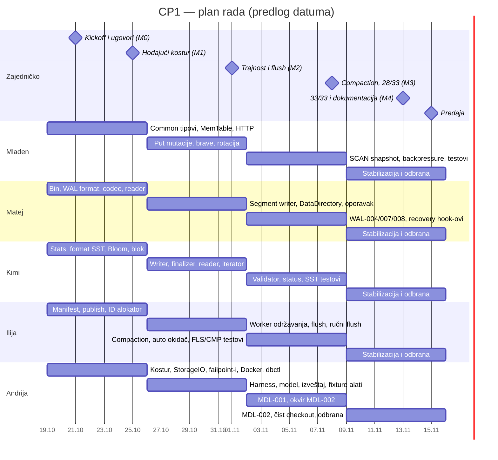
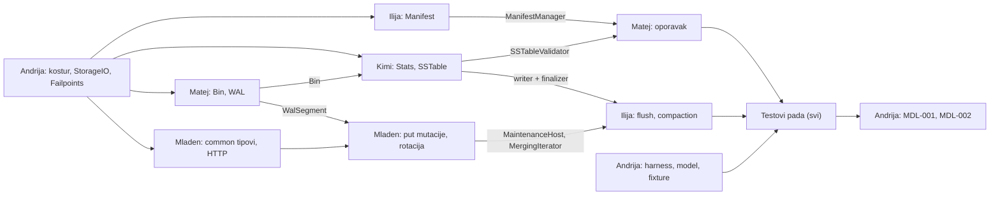

# Veliki podaci — plan rada i uputstvo za tim

## Checkpoint 1: lokalni LSM mehanizam sa garancijom trajnosti

| | |
|---|---|
| **Tim** | Mladen, Matej, Kimi, Ilija, Andrija (svi ravnopravni članovi, bez formalnog lidera) |
| **Jezik i alati** | Java 21, Maven Wrapper, JUnit 5, Docker + Compose (zvanična osnova predmeta) |
| **Rok** | ~4 nedelje. Plan pretpostavlja početak u ponedeljak 19.10.2026. i predaju oko 15.11.2026. Ako je stvarni datum drugačiji, pomerite samo datume; redosled ostaje isti. |
| **Repozitorijum** | GitHub, lagana pravila (vidi §12) |
| **Merodavni dokumenti** | `docs/spec/Project Info.md` i `docs/spec/Checkpoint 1.md`. `docs/spec/Checkpoint 2.md` služi samo za informaciju. |
| **Verzija plana** | v1, usvaja se na kickoff sastanku. Izmene se beleže u `docs/ODLUKE.md`. |

> Ovaj fajl je **zajednički ugovor tima**: ko šta radi, kojim redom i po kojim pravilima. Čitaju ga ljudi i AI alati (Claude, Copilot, Cursor, ChatGPT i ostali). Kada se ovaj plan i specifikacija razlikuju, **merodavna je specifikacija**, a plan treba ispraviti. Oznake poput „CP1 §16.4“ upućuju na odeljak fajla `Checkpoint 1.md`, a „PI §21“ na odeljak fajla `Project Info.md`.

---

## Sadržaj

0. [Ukratko](#0-ukratko)
1. [Kako koristiti ovaj dokument](#1-kako-koristiti-ovaj-dokument)
2. [Šta pravimo i kako se ocenjuje](#2-šta-pravimo-i-kako-se-ocenjuje)
3. [Tehnološke odluke](#3-tehnološke-odluke)
4. [Struktura repozitorijuma i vlasništvo nad kodom](#4-struktura-repozitorijuma-i-vlasništvo-nad-kodom)
5. [Ugovori između modula](#5-ugovori-između-modula)
6. [Podela posla po članovima](#6-podela-posla-po-članovima)
7. [Matrica: 33 obavezna testa](#7-matrica-33-obavezna-testa)
8. [Matrica: 21 failpoint](#8-matrica-21-failpoint)
9. [Brojači i polja statusa: ko ih puni](#9-brojači-i-polja-statusa-ko-ih-puni)
10. [Vremenski plan za 4 nedelje](#10-vremenski-plan-za-4-nedelje)
11. [Mapa zavisnosti i kritični put](#11-mapa-zavisnosti-i-kritični-put)
12. [Način rada: komunikacija, Git, review, Definition of Done](#12-način-rada)
13. [Inženjerska pravila (obavezno / zabranjeno)](#13-inženjerska-pravila)
14. [Pravila pisanja testova](#14-pravila-pisanja-testova)
15. [Dokumentacija za predaju](#15-dokumentacija-za-predaju)
16. [Priprema za odbranu](#16-priprema-za-odbranu)
17. [Uputstvo za AI alate](#17-uputstvo-za-ai-alate)
18. [Brza referenca](#18-brza-referenca)
19. [Pogled unapred: šta CP2 traži od koda koji sada pišemo](#19-pogled-unapred-cp2)
20. [Rizici i mitigacije](#20-rizici-i-mitigacije)
21. [Odluke za kickoff i pitanja za asistenta](#21-odluke-za-kickoff-i-pitanja-za-asistenta)
22. [Kontrolna lista pre predaje](#22-kontrolna-lista-pre-predaje)

---

## 0. Ukratko

Pravimo trajnu bazu ključ–vrednost na jednom čvoru, zasnovanu na LSM stablu: **WAL → MemTable → SSTable (retki indeks + Bloom filter) → manifest → flush → major compaction → oporavak posle `kill -9`**. Sve se pokreće kroz Docker profil `standalone` i komandu `./dbctl`. Ispravnost dokazuju **33 obavezna testa** koja koriste determinističke failpoint-e. Ovaj isti mehanizam se u CP2 i CP3 ugrađuje u svaku repliku particije, pa ga ne pišemo kao prototip za bacanje.

| Član | Oblast (vlasništvo nad kodom) | Testovi koje piše | Backup (mora znati njegov modul) |
|---|---|---|---|
| **Mladen** | Jezgro mehanizma: zapisi, redni brojevi, MemTable, rotacija, backpressure, brave, put `PUT`/`DELETE`, `GET`, k-way merge za `SCAN`, HTTP serveri i javni API | API-001..005, FLS-007, CMP-005 (**7**) | Ilija |
| **Matej** | WAL (format, writer, reader, klasifikacija završetka), direktorijum (`LOCK`, `node.json`, inicijalizacija), oporavak pri pokretanju, `inspect wal` | WAL-001..008 (**8**) | Andrija |
| **Kimi** | SSTable (blokovi, retki indeks, Bloom, footer, reader, iterator, potpuna validacija, finalizacija), `inspect sstable`, statistike, status endpoint-i, JSON logovi | SST-001..006, FLS-002 (**7**) | Matej |
| **Ilija** | Manifest (validacija, atomska objava, ID tabela), flush, compaction, radnik održavanja, admin flush/compact, `inspect manifest` | FLS-001, FLS-003..006, CMP-001..004 (**9**) | Mladen |
| **Andrija** | Platforma: Maven, Docker, Compose, `dbctl`, `StorageIO`, failpoint okvir, test harness i JSON izveštaj, referentni model, fixture alati, randomizovani testovi | MDL-001, MDL-002 (**2 velika**) i harness za sve ostale | Kimi |

**Prekretnice:** M0 – 21.10. (ugovori), M1 – 25.10. (hodajući kostur), M2 – 01.11. (trajnost i flush), M3 – 08.11. (compaction, najmanje 28/33), M4 – 13.11. (33/33 i dokumentacija), **predaja – 15.11.**

**10 zlatnih pravila**

1. WAL force uvek prethodi vidljivosti u MemTable i odgovoru klijentu (I1, I2).
2. Sav fajl I/O u produkcionom kodu prolazi kroz `StorageIO`. Nikad direktno `Files.write` ili `channel.write`, jer inače ne rade failpoint-i i `IO_ERROR`.
3. Redosled verzija određuje samo `sequence`. Nikad vreme, ID tabele, ID segmenta ili redosled listanja fajlova (I3).
4. Fajl postaje deo baze tek kroz manifest. Stanje se nikad ne rekonstruiše „best effort“ iz listinga direktorijuma (I4).
5. Oštećenje nije odsustvo: kompletan loš okvir ili blok vodi u `FAILED`, nikad u `NOT_FOUND` (I7).
6. Tombstone je prava verzija: indeksira se, ulazi u Bloom filter, preživljava flush i compaction (I8).
7. Redosled brava je `maintenanceLock → engineLock`. Nikad obrnuto.
8. U testovima `sleep` nije dokaz. Čeka se failpoint u stanju `TRIGGERED` ili status, uz ograničen rok.
9. Tuđi ugovor (interfejs, format bajtova, ime failpoint-a, polje statusa, kod greške) ne menjaš bez najave u grupi i saglasnosti vlasnika.
10. Svaki član mora umeti da objasni **ceo** sistem, ne samo svoj deo. Najmanje 4/7 poena na odbrani je uslov za prolaz.

---

## 1. Kako koristiti ovaj dokument

**Za ljude**

- Prvog dana pročitaj §0, §2, svoju sekciju u §6, §12 i §13.
- Pre nego što počneš komponentu, pročitaj odeljke specifikacije navedene u svojoj sekciji §6. Specifikacija ima „Objašnjenje za nastavu“, numerisani algoritam i tabelu „prolazak kroz korake“. Implementiraj prema numerisanom algoritmu, a objašnjenjem proveri kod.
- Pre odbrane ponovo pročitaj §16 ovog plana, invarijante I1–I9 (CP1 §7), tabele ishoda pada (CP1 §9.3, §19.3, §20.5) i Dodatak A specifikacije.

**Za AI alate**

- Pročitaj §17 ovog dokumenta (pravila za AI), zatim sekciju §6 člana koji te koristi i odeljke specifikacije na koje ona upućuje.
- Specifikacija se nalazi u `docs/spec/`. Kada nešto nije definisano, ne izmišljaj: ostavi `TODO(spec?)` i pitaj korisnika.

**Gde šta stoji u repozitorijumu**

- `PLAN_RADA_CP1.md` — ovaj fajl, u korenu repozitorijuma.
- `docs/spec/` — originalne specifikacije (Project Info, Checkpoint 1, Checkpoint 2).
- `docs/ODLUKE.md` — kratak dnevnik odluka tima (datum, odluka, ko, zašto).
- `CLAUDE.md`, `AGENTS.md`, `.github/copilot-instructions.md` — kratki fajlovi koji upućuju AI alate na ovaj plan (šablon u §17.3).

---

## 2. Šta pravimo i kako se ocenjuje

### 2.1 Obim CP1 (CP1 §1, §3–§6)

- Jedan proces baze u Docker servisu `standalone`, trajni volumen montiran na `/var/lib/dlsm`.
- Javni API na portu `8080`: `PUT /v1/kv/{key}`, `GET /v1/kv/{key}`, `DELETE /v1/kv/{key}`, `GET /v1/scan`.
- Admin/test API na portu `8082`: health, status, flush, compact, resetovanje brojača, failpoint-i.
- U CP1 nema mreže između čvorova, Raft-a, particionisanja ni replikacije. Odgovori nose veštačke vrednosti `partitionId=0` i `epoch=0`.
- Testovi ruše proces sa `SIGKILL` ili failpoint akcijom `CRASH` i pokreću nov proces nad istim volumenom.

### 2.2 Rubrika: 25 poena (CP1 §33)

| Deo | Oblast | Poeni | Glavni nosilac |
|---|---|---:|---|
| Implementacija (12) | API semantika, redni brojevi, konkurentnost | 2 | Mladen |
| | WAL trajnost, uokvirivanje, stanje greške, oporavak | 3 | Matej |
| | SSTable format, retki indeks, Bloom, skeniranje | 3 | Kimi (+ Mladen za merge) |
| | MemTable rotacija, flush, objava manifesta, čišćenje | 2 | Ilija (+ Mladen za rotaciju) |
| | Major compaction i zamena bezbedna pri padu | 2 | Ilija |
| Testovi studenata (6) | Obavezni scenariji i ispravni oracle-i | 4 | Svi |
| | Ponovljivost, nezavisan model, dijagnostika, kvalitet | 2 | Andrija (+ svi) |
| Odbrana (7) | Praćenje podataka i fajlova kroz izabrani otkaz | 3 | **Svi** |
| | Predviđanje ishoda izmenjenog failpoint scenarija | 2 | **Svi** |
| | Pronalaženje, objašnjavanje i menjanje koda | 2 | **Svi** |

> Na odbrani je neophodno najmanje **4/7** poena; u suprotnom asistent može tražiti ponovnu odbranu iako svi testovi prolaze. Osoblje se obraća **bilo kom** članu. Rečenica „to je pisao kolega“ nije odbrana (CP1 §34).

### 2.3 Namerno NE radimo u CP1 (CP1 §36)

Mrežna komunikacija, particionisanje, replikacija, Raft, transakcije, SQL, sekundarni indeksi, TTL, uklanjanje tombstone-a, leveled ili size-tiered compaction, kompresija, enkripcija, page ili block cache, zero-copy, benchmark i deljenje direktorijuma između procesa. Group commit takođe preskačemo (CP1 §9.4).

---

## 3. Tehnološke odluke

### 3.1 Fiksirano predmetom (PI §13, §14)

- **Java 21** i **Maven Wrapper** (`mvnw`) commit-ovan u repozitorijum.
- Verzije svih zavisnosti su fiksirane u `pom.xml`. Izgrađena slika ne sme ništa da preuzima pri pokretanju.
- Spoljašnji interfejsi su nezavisni od jezika: HTTP/1.1 sa UTF-8 JSON-om, imena failpoint-a, `dbctl` komande i JSON izveštaj.
- Za upis na disk zabranjeni su Java serijalizacija objekata i serijalizacija `BitSet` objekta (CP1 §15, §8.1).

### 3.2 Izbor tima (predlog za kickoff)

| Stvar | Predlog | Napomena |
|---|---|---|
| Struktura | Maven multi-module: `dlsm-core`, `dlsm-server`, `dlsm-tests` | `dlsm-core` ponovo koristi CP2 storage čvor. |
| HTTP server | Ako asistenti daju početni projekat, koristimo njegov HTTP/JSON skup. Inače JDK `com.sun.net.httpserver.HttpServer`. | Bez dodatne zavisnosti, dovoljno za CP1. |
| JSON | Jackson `jackson-databind` (fiksirana verzija, npr. 2.17.2) | Manifest, `node.json`, API, status, logovi. |
| Testovi | JUnit 5 za unit i komponentne testove, sopstveni scenario runner za 33 ID-ja | Runner izlaže tačno 33 ID-ja (§14). |
| MemTable | `TreeMap<String, InternalRecord>` pod bravom mehanizma | Prirodni redosled `String` odgovara ASCII bajtovima (CP1 §8.1). |
| Kontrolna suma | `java.util.zip.CRC32C` | Isti opseg bajtova u writer-u, reader-u, inspector-u i testovima. |
| Brojevi | Big-endian, fiksne širine, preko `ByteBuffer` sa `BIG_ENDIAN` | Svaka dužina se proverava **pre** alokacije. |
| WAL format | Tačno **preporučena osnova iz CP1 §16.3.1** (zaglavlje 24 B, okvir `30 + k + v`) | Manje dizajna i manje rizika na odbrani. |
| Brave | Preporučena osnova iz CP1 §13.1: jedan fer `ReentrantReadWriteLock engineLock` i jedan `ReentrantLock maintenanceLock` | Serijalizovano održavanje; refcount čitalaca nije potreban. |
| Bloom filter | Preporučena osnova iz CP1 §17.5: `k=7`, SHA-256 (`h1`, `h2`), `Long.remainderUnsigned` | Identifikator verzije heša čuvati u metapodacima. |
| Pakovanje blokova | `DATA_BLOCK_TARGET_BYTES = 4096` (CP1 §17.3) | Veliki zapis dobija sopstveni blok. |
| Održavanje | Jedan jednonitni `ExecutorService` i serijalizacija konkurentnih poziva (bez `409`) | CP1 §23, preporučena osnova. |
| Crash u testnom režimu | `Runtime.getRuntime().halt(137)` | Bez shutdown hook-ova (PI §21.1). |
| Test pada | Runner unutar `student-tests` pokreće produkcioni jar kao **proces dete** nad izolovanim direktorijumom (PI §25.2, opcija 2) | Brzo, deterministično, ceo skup staje u 5 minuta. |

### 3.3 Zabranjene zavisnosti (PI §8.3)

Nikakva ugrađena ili spoljašnja baza (RocksDB, LevelDB, H2, SQLite, MapDB i slične), nikakva gotova LSM implementacija, nikakav perzistentni KV pod API-jem. Ako nisi siguran za neku biblioteku, pitaj tim, a tim pita asistenta **pre** upotrebe. Svaka nova zavisnost ide u `docs/ODLUKE.md`.

---

## 4. Struktura repozitorijuma i vlasništvo nad kodom

### 4.1 Obavezno u korenu (PI §24.1)

```text
README.md            # kako se gradi, pokreće i testira          (urednik: Andrija)
DESIGN.md            # invarijante, arhitektura, brave, oporavak (urednik: Ilija)
FORMAT.md            # tačni bajtovi WAL/SST/manifesta          (urednik: Matej)
AI_USAGE.md          # upotreba AI alata, pregled, slabosti     (urednik: Andrija)
docker-compose.yml   # profil standalone + student-tests        (Andrija)
dbctl                # POSIX sh, izvršiv                        (Andrija)
config/cluster.json  # za CP1 placeholder; obavezan fajl        (Andrija)
reports/             # izveštaji testova (.gitkeep)             (Andrija)
PLAN_RADA_CP1.md     # ovaj fajl
docs/spec/           # specifikacije
docs/ODLUKE.md       # dnevnik odluka
```

### 4.2 Moduli i paketi (predlog; korenski paket, npr. `rs.raf.dlsm`, bira se na kickoff-u)

```text
dlsm-core/                         # biblioteka mehanizma, bez HTTP-a i bez Docker znanja
  common/      Keys, InternalRecord, Kind, ErrorCode, StorageException, Bin (BE + CRC32C), FileNames
  io/          StorageIO, DefaultStorageIO, InjectedIOException
  failpoint/   Failpoints, FailpointRegistry, FailpointRule, FailpointNames (svih 21 imena)
  engine/      StorageEngine (fasada), EngineConfig, OpContext, Engine, MemTable, ImmutableMemTable,
               SequenceAllocator, EngineMode, EngineView, MergingIterator, MaintenanceHost
  wal/         WalCodec, WalSegment, WalSegments, WalReader, WalScanResult, WalIdAllocator
  sstable/     SSTableWriter, SSTableFinalizer, SSTableReader, SSTableIterator, SSTableValidator,
               BlockCodec, SparseIndex, BloomFilter, SSTableMeta
  manifest/    Manifest, ManifestManager, ManifestValidator, TableIdAllocator
  maintenance/ MaintenanceWorker, FlushJob, CompactionJob, MaintenanceStatus
  recovery/    DataDirectory (LOCK, node.json, init), RecoveryProcedure
  stats/       StorageStats (svi brojači iz CP1 §24), StatusBuilder
  log/         JsonLog (JSON Lines na stdout)
  inspect/     InspectWal, InspectSSTable, InspectManifest (bez sporednih efekata)
dlsm-server/                       # proces: Main, HTTP 8080/8082, konfiguracija iz env
  http/        PublicApiHandler, AdminRouter, HealthHandler, ErrorEnvelope, Json, RequestContext
  admin/       StorageAdminHandler (flush/compact/status/reset), FailpointAdminHandler
  Main         (+ podkomanda `inspect` za dbctl)
dlsm-tests/                        # slika student-tests
  harness/     ScenarioRegistry, ScenarioRunner, Report, NodeController, ApiClient, AdminClient,
               FailpointClient, Await, VolumeTools, Trace, RequestIds
  model/       ReferenceModel, CandidateSet
  fixtures/    WalFixtureWriter (nezavisan od produkcionog koda), CorruptionTools
  scenarios/   Cp1Api001 ... Cp1Mdl002   (jedna klasa po test ID-ju)
```

### 4.3 Ko je vlasnik kog paketa

| Paket | Vlasnik | Backup |
|---|---|---|
| `common` (Keys, InternalRecord, ErrorCode) | Mladen | Ilija |
| `common/Bin` (BE + CRC32C), `wal`, `recovery`, `inspect/InspectWal` | Matej | Andrija |
| `sstable`, `stats`, `log`, `inspect/InspectSSTable`, admin status handler | Kimi | Matej |
| `manifest`, `maintenance`, `inspect/InspectManifest`, admin flush/compact handler | Ilija | Mladen |
| `engine`, `http` (serveri, javni API, health, envelope) | Mladen | Ilija |
| `io`, `failpoint`, admin failpoint handler, Docker, `dbctl`, ceo `dlsm-tests/harness`, `model`, `fixtures` | Andrija | Kimi |
| `dlsm-tests/scenarios/*` | autor testa prema §7 | vlasnik koda koji test pokriva |

„Vlasnik“ znači: odlučuje o dizajnu unutar granica specifikacije, odobrava izmene ugovora i odgovara da modul prolazi svoje testove. Ostali **smeju** da šalju izmene, ali za ugovore važi §5.3.

---

## 5. Ugovori između modula

Ugovori omogućavaju da pet ljudi radi paralelno od prvog dana: svako može da napravi stub ili fake za tuđi interfejs dok prava implementacija ne stigne. **Rok za commit potpisa: M0 (sreda 21.10.).** Ispod su predlozi koji se dorađuju na kickoff-u.

### 5.1 Ključni interfejsi (skice)

```java
// ===== common (Mladen) =====
public enum Kind { PUT((byte) 1), DELETE((byte) 2); /* kod iz FORMAT.md */ }
public record InternalRecord(String key, long sequence, Kind kind, byte[] value) {
    // value == null samo za DELETE; prazan PUT je byte[0]; konstruktor pravi zaštitnu kopiju
}
public final class Keys {               // PI §18.1
    static boolean isValid(String key); // 1..128, [A-Za-z0-9._~-]
    static int compare(String a, String b);
}
public enum ErrorCode { INVALID_REQUEST, VALUE_TOO_LARGE, NOT_FOUND, STORAGE_IO, INTERNAL_ERROR,
                        NODE_NOT_READY, DEADLINE_EXCEEDED }
public class StorageException extends Exception { ErrorCode code(); String category(); /* npr. WAL_FRAME */ }

// ===== engine (Mladen) =====
public record OpContext(String requestId, long deadlineNanos) {}   // rok po monotonom satu (System.nanoTime)
public record EngineConfig(Path dataDir, String nodeId, long memtableMaxBytes,
                           boolean testMode, Failpoints failpoints, StorageIO io, StorageStats stats) {}
public interface StorageEngine extends AutoCloseable {
    static StorageEngine open(EngineConfig cfg) throws StorageException;  // pokreće oporavak (CP1 §21)
    MutationResult put(String key, byte[] value, OpContext ctx) throws StorageException;
    MutationResult delete(String key, OpContext ctx) throws StorageException;
    GetResult get(String key, OpContext ctx) throws StorageException;     // found(bytes) | notFound
    ScanResult scan(String startInclusive, String endExclusive, int limit, OpContext ctx) throws StorageException;
    FlushResult flush(OpContext ctx) throws StorageException;             // ugovor iz CP1 §23.1
    CompactionResult compact(OpContext ctx) throws StorageException;     // ugovor iz CP1 §23.2
    StorageStatus status();                                               // CP1 §24, interno konzistentan
    long resetStats();                                                    // vraća novi resetEpoch
    Lifecycle lifecycle();                                                // RECOVERING | READY | FAILED
}
// Generički k-way merge (CP1 §12): ulaz su iteratori sortirani po ključu, najviše 1 zapis po ključu
// po izvoru; izlaz za svaki ključ daje TAČNO jedan zapis, onaj sa najvećim sequence (i tombstone).
// SCAN zatim filtrira tombstone i primenjuje limit/end. Compaction (Ilija) zadržava tombstone.
public final class MergingIterator implements Iterator<InternalRecord> { ... }

// Šav engine <-> održavanje (Mladen obezbeđuje, Ilija koristi). Usklađeno sa kodom 18.10.2026.
// (docs/ODLUKE.md); merodavan je javadoc u dlsm-core/.../engine/MaintenanceHost.java.
public interface MaintenanceHost {
    long maxSequenceInEngine(OpContext ctx) throws StorageException;        // targetSequence za ručni flush
    boolean rotateIfActiveContainsUpTo(long target, OpContext ctx)          // ručni flush: rotacija aktivne;
            throws StorageException;                                        // greška ako immutable već postoji
    Optional<FlushInput> oldestImmutable();                   // FIFO; zapisi + walSegmentIds + maxSeq
    EngineView currentView();                                 // nepromenljiv snimak: immutable + objavljene tabele
    <T> T underEngineWriteLock(OpContext ctx, Callable<T> step) throws Exception; // objava manifesta + zamena pogleda
    void installFlushResult(long memtableGeneration, TableSource table);    // povlači immutable, budi pisce
    void installCompactionResult(Set<Long> inputTableIds, TableSource output);
    void reportFatalError(StorageException cause);           // npr. IO_ERROR posle preimenovanja manifesta → FAILED
}
public interface FlushScheduler { void flushNeeded(); void checkAutoCompaction(); default void close() {} } // Ilija obezbeđuje; ne sme da blokira
// Ulaz za oporavak (Matej poziva na kraju RecoveryProcedure, CP1 §21.1 koraci 10–15):
public record RecoveredState(long lastUsedSequence,              // max(flushedThroughSequence, najveći ispravan WAL seq)
                             ImmutableMemTable recoveredGeneration, // replay iznad flushedThrough u generaciju 1, ili null
                             List<TableSource> tables,             // sve tabele iz manifesta, već validirane
                             MutationLog activeLog,                // nov, trajan, prazan WAL segment (ID iznad svih starih)
                             WalFactory walFactory) {}             // pravi naredne segmente pri rotaciji
static Engine Engine.open(EngineConfig cfg, RecoveredState state,
                          Function<MaintenanceHost, FlushScheduler> maintenance); // READY; odmah traži flush oporavljene
                                                                                 // generacije i checkAutoCompaction()
// Objavljena SSTable kako je engine čita; Kimijev SSTableReader je implementira.
public interface TableSource {
    SSTableMeta meta();
    Optional<InternalRecord> get(String key) throws StorageException;            // kandidat, može biti tombstone
    Iterator<InternalRecord> iterator(String startInclusive) throws StorageException; // pozicioniran kroz retki indeks
}   // oštećenje: StorageException (STORAGE_IO + kategorija), u iteratoru UncheckedStorageException; nikad prazan rezultat

// ===== io + failpoint (Andrija) =====
public interface StorageIO {   // fpBefore = ime failpoint-a koji se pogađa NEPOSREDNO pre stvarnog poziva (ili null)
    FileChannel openNew(Path p) throws IOException;
    void writeFully(FileChannel ch, ByteBuffer buf, String fpBefore, OpContext ctx) throws IOException;
    void force(FileChannel ch, String fpBefore, OpContext ctx) throws IOException;
    void atomicMoveNoReplace(Path from, Path to, String fpBefore, OpContext ctx) throws IOException; // finalizacija SST/WAL
    void atomicReplace(Path from, Path to, String fpBefore, OpContext ctx) throws IOException;      // MANIFEST.json
    void fsyncDirectory(Path dir, String fpBefore, OpContext ctx) throws IOException;
    void truncate(FileChannel ch, long size) throws IOException;
    void delete(Path p) throws IOException;
}
public interface Failpoints {
    void hit(String name, OpContext ctx) throws InjectedIOException; // PAUSE blokira, CRASH halt, IO_ERROR baca
    OptionalInt intParameter(String name, OpContext ctx, String param); // npr. "prefixBytes"
}

// ===== wal (Matej) =====
WalSegment WalSegments.create(Path walDir, Path tmpDir, long segmentId, OpContext ctx); // CP1 §16.1 protokol
long  WalSegment.append(InternalRecord r, OpContext ctx);  // ceo okvir; vraća početni offset; wal.before-append, wal.after-record-prefix
void  WalSegment.force(OpContext ctx);                     // fpBefore = wal.after-append.before-sync
WalScanResult WalReader.scan(Path segmentFile);            // VALID | TORN_TAIL(frameStart, eof) | CORRUPT(offset, reason)

// ===== sstable (Kimi) =====
public record SSTableMeta(long tableId, String file, String minKey, String maxKey,
                          long minSequence, long maxSequence, long entryCount, long sizeBytes) {}
SSTableMeta SSTableWriter.write(Path tmpFile, long tableId, Iterator<InternalRecord> sortedUnique,
                                long expectedEntries, OpContext ctx);
void SSTableFinalizer.finalizeTable(Path tmp, Path finalPath, OpContext ctx); // force -> atomic move -> fsync sst/ (+3 failpoint-a)
SSTableReader SSTableReader.open(Path file, SSTableMeta expected, StorageStats stats);
Optional<InternalRecord> SSTableReader.get(String key);        // kandidat, može biti tombstone
CloseableIterator<InternalRecord> SSTableReader.iterator(String startInclusive);
static void SSTableValidator.validateFully(Path file, SSTableMeta expected); // strimovanje, baca kategoriju

// ===== manifest (Ilija) =====
public record Manifest(int formatVersion, long generation, long nextTableId,
                       long flushedThroughSequence, List<SSTableMeta> sstables) {}
Manifest ManifestManager.loadAndValidate();                 // CP1 §18.2 (strukturna provera; sadržaj SST proverava recovery)
void     ManifestManager.publish(Manifest next, OpContext ctx); // CP1 §18.1 koraci 1–4 + 2 failpoint-a
long     TableIdAllocator.next();                           // CP1 §18.3
```

### 5.2 Zajednički ugovori koji nisu Java kod

| Ugovor | Vlasnik | Gde se zapisuje | Rok |
|---|---|---|---|
| WAL format bajtova (zaglavlje + okvir) | Matej | `FORMAT.md` §WAL | M0 |
| SSTable format (oblasti, blok, indeks, Bloom, footer) | Kimi | `FORMAT.md` §SSTable | M0 nacrt, M1 konačno |
| Šema `MANIFEST.json` i `node.json` | Ilija (manifest), Matej (`node.json`) | `FORMAT.md` §Manifest | M0 |
| Imena 21 failpoint-a i podržane akcije | Andrija (konstante), vlasnici mesta postavljanja | `FailpointNames.java` | Dan 1 |
| Imena brojača (CP1 §24) | Kimi | `StorageStats.java` | Dan 2 |
| JSON statusa (CP1 §24) | Kimi | `StatusBuilder` + primer u `DESIGN.md` | M1 |
| Kodovi grešaka i kategorije dijagnostike | Mladen (API), Matej i Kimi (kategorije) | `ErrorCode`, `DESIGN.md` | M1 |
| Test ID-jevi (33) i format izveštaja | Andrija | `ScenarioRegistry`, PI §25.3 | M1 |

### 5.3 Protokol izmene ugovora

1. U grupnom chatu napiši: `IZMENA UGOVORA: <šta> — <zašto> — <ko je pogođen>`.
2. Otvori PR. Za ugovore je PR **obavezan** i to je jedini izuzetak od laganih Git pravila. Vlasnik ugovora mora da odobri.
3. Posle merge-a dodaj jedan red u `docs/ODLUKE.md`.
4. Ako se menja format bajtova, u istom PR-u ažuriraj `FORMAT.md`, inspector i fixture alate.

---

## 6. Podela posla po članovima

Svaka sekcija ima isti oblik: cilj, šta pročitati, isporuke, failpoint-i, brojači, testovi, dokumentacija i zavisnosti. Polja za štikliranje (`[ ]`) vodi sam vlasnik.

### 6.1 Mladen — jezgro mehanizma i javni API

**Cilj.** Uređen tok mutacija sa tačnom tačkom linearizacije, dve generacije u memoriji, bezbedna rotacija i backpressure, ispravno razrešavanje verzija pri čitanju i HTTP sloj koji tačno prati zajednički API.

**Obavezno pročitati.** CP1 P0.1–P0.17, §4–§6, §8–§13, §22, §28.2. PI §5–§6, §17, §18, §20.1.

**Isporuke**

- [x] `InternalRecord`, `Kind`, `Keys` (validacija i poređenje), `ErrorCode`, `StorageException` — **dan 1–2**, jer ih svi koriste.
- [x] `SequenceAllocator`: počinje od 1, opseg `1..2^63-1`, pri prekoračenju mehanizam prelazi u `FAILED` (CP1 §6).
- [x] `MemTable`: `TreeMap`, čuva samo najveći `sequence` po ključu, `logicalBytes = 32 + len(key) + len(value)` (0 za tombstone i praznu vrednost), `generation`, `min/maxSequence`, `rotationRequired`. `ImmutableMemTable` kao pogled samo za čitanje (CP1 §10).
- [x] `EngineMode` mašina stanja `RECOVERING → SERVING ⇄ BACKPRESSURED → FAILED` i `lastFatalError`. Iz `FAILED` nema povratka bez restarta (CP1 §22).
- [x] Brave po CP1 §13.1: fer `ReentrantReadWriteLock engineLock`. Za backpressure se koristi `engineLock.writeLock().newCondition()`, jer `await` oslobađa bravu. Redosled brava se dokumentuje u `DESIGN.md`.
- [x] Put mutacije u **10 koraka** (CP1 §9) za `PUT` i `DELETE`: validacija pre bilo kakvog sporednog efekta → write lock → provera režima i backpressure-a sa rokom → dodela `sequence` → kodiranje → `WalSegment.append` → `WalSegment.force` → MemTable → vidljivost → odgovor. I/O greška u append ili force vodi u `FAILED`. *(Pravi `WalSegment` stoji iza šava `MutationLog`; čvor ga otvara kroz `RecoveryProcedure`.)*
- [x] Rotacija u **4 koraka** (CP1 §10): novi WAL kroz `WalSegments.create` → zamrzavanje stare generacije → atomska zamena para (MemTable, WAL) → `FlushScheduler.flushNeeded()`. Najviše jedna immutable generacija; inače backpressure. *(Pravi `WalSegments` stoji iza šava `WalFactory`.)*
- [x] `GET` (CP1 §11): aktivna → immutable → SSTable čiji opseg pokriva ključ. Bira se najveći `sequence`; tombstone daje `NOT_FOUND`. Čitanje drži read lock tokom cele pretrage.
- [x] `MergingIterator` i `SCAN` (CP1 §12): min-heap, grupisanje **svih** verzija istog ključa, pobednik po najvećem `sequence`, tombstone se ne emituje i ne broji u `limit`, `endExclusive` se nikad ne emituje. Read lock se drži tokom celog skeniranja (osnova).
- [x] `MaintenanceHost` za Ilijin flush i compaction (§5.1): nepromenljiv `EngineView`, zamena pogleda i buđenje pisaca pod write lock-om.
- [x] HTTP serveri na `8080` i `8082` (bootstrap, router, `ErrorEnvelope`, JSON pomoćnik) — **do M0**, da ostali mogu da kače svoje handler-e.
- [x] Javni API (PI §17–§18): `X-Request-Id` (1–64, `[A-Za-z0-9._:-]`, vraća se u odgovoru), `X-Request-Timeout-Ms` (100..10000, podrazumevano 5000, pretvara se u `deadlineNanos`), strogi standardni Base64 sa dopunom (dužina mora biti deljiva sa 4, jer Java dekoder inače prihvata i nedopunjen ulaz), najviše 262 144 dekodirana bajta (`VALUE_TOO_LARGE`), `Cache-Control: no-store`, bez stack trace-ova i apsolutnih putanja u odgovorima, `partitionId=0`, `epoch=0`, scan sa `observedPartitions:[{"partitionId":0,"epoch":0}]`.
- [x] `GET /health/live` i `GET /health/ready` na `8082` (`503` sa stanjem životnog ciklusa dok nije spreman).

**Failpoint-i koje postavlja:** `wal.after-sync.before-memtable`, `memtable.after-apply.before-response`, `rotation.after-new-wal-sync.before-switch`, `rotation.after-switch.before-flush`, `scan.after-snapshot.before-merge`.

**Polja statusa koja obezbeđuje:** `engineMode`, `writeBackpressure`, `backpressuredWriters`, `lastFatalError`, `nextSequence`, `activeMemtable`, `immutableMemtable`, `lastAcceptedSequence`, `lastDurableSequence`.

**Testovi:** CP1-API-001, API-002, API-003, API-004, API-005, FLS-007 (backpressure), CMP-005 (trka flush-a i compaction-a; namerno testira Ilijin kod). ✅ Svi su napisani i prolaze u Docker-u (28.10.2026.); odgovori za odbranu su u `docs/odbrana/`.

**Dokumentacija (`DESIGN.md`):** granice modula, tačka linearizacije i redosled WAL force-a, tabela brava i redosled preuzimanja, rotacija i backpressure, algoritmi `GET` i `SCAN`.

**Zavisi od:** Matej (`WalSegment`; dok ne stigne, koristi in-memory fake), Kimi (`SSTableReader.get` i `iterator`), Ilija (`FlushScheduler`), Andrija (`StorageIO`, `Failpoints`, harness).
**Od njega zavise:** svi (common tipovi, HTTP serveri), Ilija (`MaintenanceHost`, `MergingIterator`), Kimi (polja statusa).

### 6.2 Matej — WAL, direktorijum i oporavak

**Cilj.** Dnevnik koji tačno razlikuje nepotpun završetak od oštećenja, bezbedan protokol stvaranja segmenta i idempotentan oporavak u 15 koraka koji nikad ne izmišlja niti gubi potvrđene mutacije.

**Obavezno pročitati.** CP1 P0.5, P0.13–P0.14, §6, §14–§16, §21, §25 (`inspect wal`), §26.1–§26.3 (wal i recovery hook-ovi), §29.2 (svih 8 WAL testova). PI §23.

**Isporuke**

- [x] `common/Bin`: big-endian čitanje i pisanje, ograničeno čitanje dužina, CRC32C pomoćnik — **dan 1–2**, koriste ga i Kimi i Ilija.
- [x] `FORMAT.md` §WAL: tačno preporučena osnova iz CP1 §16.3.1 (magic `LSMWAL01`, zaglavlje 24 B, okvir `totalFrameLength`, komplement, verzija, vrsta, `sequence`, `k`, `v`, CRC preko bajtova `8..25+k+v`), sa heksadecimalnim primerom jednog zapisa — **M0**.
- [x] `WalCodec`: enkoder i dekoder sa tačnim redosledom provere: 8-bajtno zaštićeno zaglavlje → komplement → granice → tek onda alokacija → unutrašnje dužine → vrsta i ključ → CRC (CP1 §16.3.1). Unit testovi round-trip i za svaku klasu greške.
- [x] `WalSegments.create`: privremeni fajl → zaglavlje → force → `atomicMoveNoReplace` na `wal-<20 cifara>.log` → `fsyncDirectory(wal/)`. `WalIdAllocator` = `max(1, 1 + najveći ispravan ID u wal/ ili tmp/)` (CP1 §16.1).
- [x] `WalSegment.append` i `force`: petlja dok se ne upišu svi bajtovi; failpoint `wal.after-record-prefix` sa parametrom `prefixBytes` (CRASH upisuje tačno prefiks pa staje; PAUSE čeka posle prefiksa; IO_ERROR ostavlja prefiks). Brojači na tačnim granicama iz CP1 §24.
- [x] `WalReader.scan`: `VALID`, `TORN_TAIL` (početak okvira i EOF) ili `CORRUPT` (offset i razlog: `WAL_FRAME`, `WAL_LENGTH_GUARD`, `CHECKSUM`, `WAL_HEADER`, `WAL_SEQUENCE_ORDER`). Strogo rastući `sequence` kroz segmente; ID u zaglavlju mora odgovarati imenu fajla (CP1 §16.4).
- [x] `DataDirectory`: `LOCK` kroz `FileChannel.tryLock()` koji se drži dok proces živi; `node.json` sa atomskim upisom; prva inicijalizacija u 5 koraka i klasifikacija delimično inicijalizovanog stanja (CP1 §14.1–§14.2). Nepodudaran ili nedostajući identitet u nepraznoj bazi daje `FAILED`.
- [x] `RecoveryProcedure`, svih **15 koraka** iz CP1 §21.1. Poziva Ilijin `ManifestManager.loadAndValidate` i Kimijev `SSTableValidator.validateFully`, čisti privremene i orphan fajlove (uz brojače), skenira WAL po ID-ju, odseca **samo** nepotpun završetak i radi force, replay iznad `flushedThroughSequence` u jednu oporavljenu immutable generaciju (generacija 1, aktivna dobija 2), postavlja `nextSequence = max(flushedThrough, najveći ispravan WAL seq) + 1`, pravi **nov** aktivni WAL, briše pokrivene i prazne segmente, gradi reader-e i tek tada `READY`.
- [x] Odluka (dokumentuje se): oporavljena immutable generacija ide u flush **odmah posle READY** (predlog).
- [x] `inspect wal`: deterministički izlaz, klasifikacija, izlazni kod 0 za `VALID` i `TORN_TAIL`, različit od nule za `CORRUPT`. Nikad ne menja fajl (CP1 §25).

**Failpoint-i:** `wal.before-append`, `wal.after-record-prefix`, `wal.after-append.before-sync` (sva tri i sa `IO_ERROR`), `recovery.after-manifest-load`, `recovery.after-wal-tail-truncate`, `recovery.after-wal-replay.before-ready`.

**Brojači:** `walAppendAttempts`, `walAppendsCompleted`, `walForceAttempts`, `walForcesSucceeded`, `walBytesWritten`, `walRecordsReplayed`, `walTornTailsTruncated`, kao i `orphanFilesRemoved` i `temporaryFilesRemoved` za čišćenje tokom oporavka.

**Polja statusa:** niz `walSegments` (`segmentId`, `role` ∈ `ACTIVE | IMMUTABLE | COVERED_PENDING_DELETE`, `min/maxSequence`, `sizeBytes`).

**Testovi:** CP1-WAL-001 do WAL-008. Za WAL-007 pripremljeni volumen pravi Andrijin `WalFixtureWriter`, koji je nezavisan od produkcionog koda; Matej ga proverava prema `FORMAT.md`.

**Dokumentacija:** `FORMAT.md` (urednik celog fajla, WAL i `node.json`), `DESIGN.md` §oporavak i politika oštećenja.

**Zavisi od:** Andrija (`StorageIO`, `Failpoints`, bootstrap failpoint-i), Ilija (`ManifestManager`), Kimi (`SSTableValidator`), Mladen (`MemTable`, `EngineView` za instalaciju oporavljenog stanja).
**Od njega zavise:** Mladen (append i force u putu mutacije, rotacija), Ilija (brisanje pokrivenih WAL segmenata posle flush-a), Kimi (`Bin`).

### 6.3 Kimi — SSTable, indeks, Bloom filter i status

**Cilj.** Nepromenljiv, samoopisujući i kontrolnim sumama zaštićen fajl na disku, sa ograničenim čitanjem (najviše 2 bloka po pretrazi), Bloom filterom bez lažno negativnih rezultata, iteratorom koji se pozicionira kroz indeks i potpunom validacijom pri pokretanju. Uz to: brojači, status endpoint-i i strukturirani logovi.

**Obavezno pročitati.** CP1 P0.7–P0.9, §11.1–§11.2, §12 (pozicioniranje iteratora), §15, §17, §18.1 (finalizacija), §24, §25 (`inspect sstable`), §27, §29.4. PI §20.

**Isporuke**

- [x] `StorageStats`: svi brojači iz CP1 §24 sa **tačnim** imenima, `AtomicLong`, `resetEpoch` — **dan 2**, jer ih svi uvećavaju.
- [x] `JsonLog`: jedan JSON objekat po redu na stdout sa poljima iz PI §20.3 i CP1 §27, bez sadržaja vrednosti — **do M1**.
- [x] `FORMAT.md` §SSTable: zaglavlje (magic, verzija, `tableId`), blokovi podataka (okvir, zapisi, CRC32C), retki indeks (prvi ključ → offset, dužina; CRC), Bloom (`m`, `k`, ID heša, bitovi, CRC), footer fiksne veličine (offset-i i dužine oblasti, min/max ključ, min/max seq, `entryCount`, CRC). Heksadecimalni ili dekodirani primer male tabele.
- [x] `BloomFilter`: `m = max(64, 10n)` bitova zaokruženo na cele bajtove, `k=7`, SHA-256 → `h1`, `h2` (h2 neparan), proba `h1 + i*h2`, `Long.remainderUnsigned(x, m)`, eksplicitna serijalizacija `byte[]` sa dokumentovanim numerisanjem bitova (CP1 §17.5).
- [x] `SSTableWriter`: strimovanje iz uređenog ulaza bez duplikata (odbija opadajući ili dupli ključ), pravilo pakovanja od 4096 bajtova, tombstone ide u blok i u Bloom, footer, samoprovera produkcionim reader-om, vraća `SSTableMeta` (CP1 §17.6, 8 koraka).
- [x] `SSTableFinalizer`: `force(tmp)` → `atomicMoveNoReplace(tmp, sst/sst-<id>.sst)` (postojeće odredište je greška) → `fsyncDirectory(sst/)`. Ovde žive sva tri `sstable.*` failpoint-a. Koriste ga i flush i compaction.
- [x] `SSTableReader.open`: validacija footer-a i oblasti, indeks i Bloom u memoriji. `get(key)`: opseg → Bloom → binarna pretraga indeksa (poslednji prvi-ključ ≤ traženi) → jedno čitanje bloka (najviše dva) → CRC → pretraga unutar bloka. Oštećenje daje `StorageException`, **nikad** `NOT_FOUND` (CP1 §11.2).
- [x] `SSTableIterator`: pozicioniranje kroz indeks blizu `startInclusive`, zatim redom kroz blokove. Nikad od nultog bloka (CP1 §12, §17.4).
- [ ] `SSTableValidator.validateFully`: strimovanje kroz ceo fajl (zaglavlje, svaki blok i njegov CRC, redosled ključeva, indeks, Bloom, footer, granice oblasti, slaganje sa manifestom) bez držanja svih blokova u memoriji. Kategorije: `DATA_BLOCK`, `INDEX`, `BLOOM`, `FOOTER`, `TRUNCATED_REGION`, `MANIFEST_TABLE_MISMATCH` (CP1 §17.3, §29.4 SST-006).
- [x] `inspect sstable <file-or-table-id>`: zaglavlje, CRC status, blokovi i offset-i, stavke indeksa, zapisi sa `sequence` i vrstom, jasna razlika između tombstone-a i prazne vrednosti.
- [x] Status endpoint-i: `GET /admin/v1/storage/status` (pun JSON iz CP1 §24, snimak pod engine read lock-om, nizovi sortirani po ID-ju), `GET /admin/v1/status` (`standaloneStorage`, `partitions:[{partitionId:0, role:"PRIMARY", epoch:0, ...}]`, `metadataRevision=0`, `metadataLeaderId=null`) i `POST /admin/v1/storage/stats/reset`.

**Failpoint-i:** `sstable.after-write.before-sync`, `sstable.after-sync.before-rename`, `sstable.after-rename.before-directory-sync` (sva tri i sa `IO_ERROR`).

**Brojači:** `sstableDataBlocksRead`, `sstableDataBytesRead`, `bloomNegativeSkips`, `bloomPositiveProbes`, `rangeScanBlocksRead` (scan **ne** konsultuje Bloom), `resetEpoch`.

**Testovi:** CP1-SST-001 do SST-006 i CP1-FLS-002 (pad pre force-a ili preimenovanja SSTable; Kimijevi hook-ovi). Za SST-006 podslučajeve (g) i (h) (manifest) radi zajedno sa Ilijom.

**Dokumentacija:** `FORMAT.md` §SSTable, `DESIGN.md` §put čitanja kroz SSTable i §status.

**Zavisi od:** Matej (`Bin`), Andrija (`StorageIO`, `Failpoints`), Mladen (polja statusa iz engine-a), Ilija (polja manifesta i održavanja).
**Od njega zavise:** Ilija (writer i finalizer za flush i compaction), Mladen (reader za `GET` i `SCAN`), Matej (validator u oporavku), svi (`StorageStats`).

### 6.4 Ilija — manifest, flush, compaction i održavanje

**Cilj.** Atomsko i trajno objavljivanje stanja, prenos zaštite sa WAL-a na SSTable bez rupe, major compaction koji ne menja logički sadržaj, i sve to bezbedno pri padu na svakoj granici.

**Obavezno pročitati.** CP1 P0.11–P0.12, §18, §19, §20, §23, §24 (polja `manifest`, `sstables`, `maintenance`), §26 (manifest, flush i compaction hook-ovi), §29.3, §29.5, Dodatak A.2–A.3.

**Isporuke**

- [ ] `Manifest` (record + Jackson) i `ManifestValidator` (CP1 §18.2: JSON, verzija, generacije, duplikati ID-ja ili fajlova, high-water konzistentnost). Početni manifest generacije 0 iz CP1 §14.2.
- [ ] `ManifestManager.publish` (CP1 §18.1): kompletan sledeći manifest → `tmp/MANIFEST-<gen>.tmp` → force → `atomicReplace(…, lsm/MANIFEST.json)` → `fsyncDirectory(lsm/)` → tek onda zamena pogleda i brisanje. Objavljivanje je serijalizovano i uvek računa izmenu nad **najnovijim** manifestom (rebase).
- [ ] `TableIdAllocator`: `runtimeNextTableId = max(manifest.nextTableId, 1 + najveći ispravan ID u sst/ ili tmp/)`, računa se **pre** čišćenja (CP1 §18.3).
- [ ] `MaintenanceWorker`: jednonitni `ExecutorService`, `maintenanceLock`, red poslova, faze `IDLE | CAPTURE | WRITE_OUTPUT | SYNC_OUTPUT | FINALIZE_OUTPUT | PUBLISH_MANIFEST | RETIRE_INPUTS | CLEANUP` vidljive u statusu. Greška posla se prijavljuje, nikad se tiho ne gubi.
- [ ] `FlushJob`, **13 koraka** iz CP1 §19.1: FIFO najstarija immutable → ID → `tmp/sst-<id>.sst.tmp` → Kimijev writer → finalizer → novi manifest sa novom tabelom i pomerenim `flushedThroughSequence` → objava pod engine write lock-om → `installFlushResult` (povlačenje immutable i buđenje pisaca) → brisanje WAL segmenata potpuno pokrivenih high-water mark-om → `fsyncDirectory(wal/)`.
- [ ] Ugovor ručnog flush-a (CP1 §23.1): uhvati `targetSequence`, FIFO flush dok nije pokriven, `PUBLISHED` ili `NO_OP`, tačan JSON odgovora. Endpoint `POST /admin/v1/storage/flush` prihvata prazno telo ili `{}` i poštuje rok.
- [ ] `CompactionJob`, **10 koraka** iz CP1 §20.3: izbor svih objavljenih tabela (ručno ≥ 2, automatski ≥ 4) → `MergingIterator` koji **zadržava** tombstone i najveći `sequence` → Bloom dimenzionisan prema zbiru `entryCount` → finalizer → ponovna provera ulaza pod zaštitom objave → manifest koji uklanja **tačno** izabrane ulaze, dodaje izlaz i **ne** pomera `flushedThroughSequence` → `installCompactionResult` → brisanje ulaza → `fsyncDirectory(sst/)`.
- [ ] Automatski okidač: posle oporavka i posle svake objave manifesta, ako postoje najmanje 4 tabele i nijedan auto compaction nije u redu ili u toku, stavi jedan u red; po završetku proveri ponovo (CP1 §20.1).
- [ ] Ugovor ručnog compaction-a (CP1 §23.2) i endpoint `POST /admin/v1/storage/compact`.
- [ ] Ponašanje posle grešaka održavanja (predlog za `ODLUKE.md`): `IO_ERROR` pre preimenovanja manifesta ili u `sstable.*` → posao ne uspeva, mehanizam ostaje `SERVING`, ponovni pokušaj je dozvoljen. `IO_ERROR` posle preimenovanja manifesta → `FAILED` (obavezno, CP1 §26.1).
- [ ] `inspect manifest`.

**Failpoint-i:** `manifest.after-temp-sync.before-rename` i `manifest.after-rename.before-directory-sync` (oba i sa `IO_ERROR`), `flush.after-sstable-finalize.before-manifest`, `flush.after-manifest-publish.before-wal-delete`, `compaction.after-selection.before-output`, `compaction.after-output-finalize.before-manifest`, `compaction.after-manifest-publish.before-input-delete`.

**Brojači:** `flushAttempts`, `flushPublications`, `compactionAttempts`, `compactionPublications` (ručni `NO_OP` ne uvećava nijedan). `temporaryFilesRemoved` kada održavanje samo čisti svoj neuspeli izlaz.

**Polja statusa:** `manifest` (`generation`, `nextTableId`, `flushedThroughSequence`, `sstableCount`), niz `sstables`, `maintenance` (`operation`, `phase`, `targetSequence`, `inputTableIds`).

**Testovi:** CP1-FLS-001, FLS-003, FLS-004, FLS-005, FLS-006, CMP-001, CMP-002, CMP-003, CMP-004.

**Dokumentacija:** urednik `DESIGN.md` (sastavlja delove ostalih), §objavljivanje pri flush-u i compaction-u; `FORMAT.md` §Manifest.

**Zavisi od:** Kimi (writer, finalizer, reader), Mladen (`MaintenanceHost`, `MergingIterator`, rotacija), Matej (lista WAL segmenata i njihovi opsezi za brisanje), Andrija (`StorageIO`, `Failpoints`).
**Od njega zavise:** Matej (`ManifestManager` u oporavku), Mladen (`FlushScheduler`), Kimi (polja statusa).

### 6.5 Andrija — platforma, failpoint okvir, test harness i randomizovani testovi

**Cilj.** Sve što omogućava da se sistem ponovljivo izgradi, pokrene, sruši na tačnoj granici, pregleda i oceni: od `./dbctl` do JSON izveštaja. Plus nezavisan referentni model i dva najveća testa.

**Obavezno pročitati.** PI §14–§17, §20–§26. CP1 §3, §26 (ceo), §28 (ceo), §29 „Zajednička pravila za svaki scenario“, §29.6, §30, §32.

**Isporuke**

- [ ] **Dan 1:** kostur repozitorijuma (multi-module Maven + wrapper, Java 21, fiksirane verzije JUnit 5 i Jackson), `.gitignore`, sve obavezne stavke u korenu (§4.1), `docs/spec/`, `FailpointNames.java` sa svih 21 imenom.
- [ ] `StorageIO` (§5.1) i `DefaultStorageIO`: `writeFully` u petlji, `FileChannel.force(true)`, `Files.move(..., ATOMIC_MOVE)` (bez i sa `REPLACE_EXISTING`), `fsyncDirectory` preko `FileChannel.open(dir, READ).force(true)`, `truncate`, `delete`. `fpBefore` pogađa failpoint neposredno pre stvarnog poziva; `IO_ERROR` baca `InjectedIOException extends IOException`, pa greška ide **istom** granom kao prava (CP1 §26.4). **Spike do M0:** proveri `fsyncDirectory` i `ATOMIC_MOVE` u stvarnoj Docker slici na imenovanom volumenu.
- [ ] Failpoint okvir (PI §21, CP1 §26): pravila sa poljima `token`, `name`, `action` (`PAUSE | CRASH | IO_ERROR | RETURN_ERROR`), `afterHits`, `maxTriggers`, `filters` (`requestId`, `partitionId`), `errorCode`, `pauseTimeoutMs`, `parameters.prefixBytes`; stanja `ARMED | TRIGGERED | RELEASED | EXHAUSTED | UNKNOWN`; `PAUSE` blokira samo tu operaciju (latch) i posle roka nastavlja sa determinističkom timeout greškom; `CRASH` → `halt`. Endpoint-i: `GET /admin/v1/failpoints/catalog`, `PUT|GET|DELETE /admin/v1/failpoints/{token}`, `POST /admin/v1/failpoints/{token}/release`, `DELETE /admin/v1/failpoints`. Rade **samo** uz `TEST_MODE=true`.
- [ ] Bootstrap failpoint-i: `DLSM_TEST_BOOTSTRAP_FAILPOINTS_B64` se parsira pre oporavka; neispravan Base64, JSON, pravilo ili upotreba van testnog režima prekidaju pokretanje pre bilo kakve izmene fajlova (CP1 §26.3).
- [ ] Docker: višefazni `Dockerfile` (Maven build u kontejneru → JRE 21 runtime), slika za `standalone` i slika za `student-tests`. `docker-compose.yml` sa profilom `standalone`, imenovanim volumenom na `/var/lib/dlsm`, `restart: "no"` i env promenljivama `TEST_MODE`, `MEMTABLE_MAX_BYTES`, `NODE_ID=standalone`.
- [ ] `dbctl` (POSIX sh, izlazni kod 0 samo pri uspehu): `build`, `up standalone` (čeka spremnost, ≤ 20 s), `down` (volumeni ostaju), `reset` (briše samo projektne volumene i privremene izveštaje), `status`, `logs`, `test checkpoint-1 --list | --seed N | --case ID --seed N`, `inspect manifest | wal | sstable <id>` (kratkotrajni pomoćni kontejner nad **zaustavljenim** volumenom).
- [ ] Harness (`dlsm-tests/harness`):
  - `ScenarioRegistry` sa tačno 33 stabilna ID-ja i `ScenarioRunner` (`--list`, `--case`, `--seed`).
  - `Report` → `reports/checkpoint-1-<seed>.json` po PI §25.3 (`PASSED | FAILED | SKIPPED`, faza neuspeha, dijagnostika, `artifactPaths`); izveštaj se upisuje i kada priprema padne.
  - `NodeController`: pokreće produkcioni jar kao proces dete nad izolovanim direktorijumom i portovima, čeka spremnost uz rok, `kill -9` (`destroyForcibly`), čeka izlaz, restartuje nad istim direktorijumom.
  - `ApiClient`, `AdminClient`, `FailpointClient`.
  - `Await.until(uslov, rok)`: periodična provera; `sleep` nikad nije dokaz.
  - `VolumeTools`: kloniranje direktorijuma, promena tačno jednog bajta (beleži fajl, offset, stari i novi bajt, dužinu), skraćivanje.
  - `RequestIds` (izvedeni iz ID-ja scenarija, seed-a i indeksa operacije) i `Trace` (poziv, odgovor, timeout, prekid veze).
- [ ] `ReferenceModel` (`TreeMap<String, byte[]>`, potpuno nezavisan od produkcionog koda) i `CandidateSet` za dvosmislene ishode (CP1 §28.3) — **do M1**, jer ga Mladen koristi od prvih API testova.
- [ ] `WalFixtureWriter` (piše WAL **samo** na osnovu `FORMAT.md`, za WAL-007) i `CorruptionTools` za WAL-003, SST-006 i MDL-002.
- [ ] CP1-MDL-001: ≥ 10 000 operacija sa seed-om (45 % PUT, 20 % DELETE, 20 % GET, 15 % SCAN), ≥ 20 ručnih flush-eva, ≥ 5 compaction-a, ≥ 10 `kill -9` + restart, ≥ 1 automatski compaction, faza validacije sa neispravnim ulazima (CP1 §29.6).
- [ ] CP1-MDL-002: ≥ 50 ciklusa pada, svaki od 21 failpoint-a bar jednom sa `CRASH`, svih 8 `IO_ERROR` mapiranja, iteracije oštećenja, zaštita pokretanja (drugi proces, `node.json`, nedostajući manifest). **Redove oracle matrice za svoje hook-ove pišu vlasnici** (§8), a Andrija pravi okvir kampanje.
- [ ] (Opciono) GitHub Actions: `./mvnw -q verify` na svaki push na `main`.

**Testovi:** CP1-MDL-001, CP1-MDL-002, plus podrška svima za harness.

**Dokumentacija:** urednik `README.md` i `AI_USAGE.md`; `DESIGN.md` §failpoint-i i §test arhitektura.

**Zavisi od:** svih za MDL testove (N3–N4).
**Od njega zavise:** **svi, od prvog dana** (kostur, `StorageIO`, `Failpoints`, harness). Zato prvo isporučuje stubove: no-op `Failpoints` i `DefaultStorageIO` bez failpoint-a do dana 2, pa pune verzije do M1.

> **Napomena o opterećenju:** Andrijin deo je najveći na početku, a ostali najveći u N2 i N3. Ako Andrija kasni sa harness-om, Kimi (backup) preuzima `Report` i `ScenarioRegistry`, a autori testova sami pišu fixture-e za svoje scenarije.

---

## 7. Matrica: 33 obavezna testa

Svaki test je zasebna klasa u `dlsm-tests/scenarios/` i zasebno se pokreće: `./dbctl test checkpoint-1 --case <ID> --seed N`. **Autor** piše test; **vlasnik koda** je odgovoran da testirani kod prođe. „Ciljna nedelja“ je kada test treba prvi put da prođe.

| # | ID | Scenario (CP1 §29) | Autor | Vlasnik koda | Ključni failpoint / alat | Ciljna nedelja |
|---:|---|---|---|---|---|---|
| 1 | CP1-API-001 | Upis, čitanje, prepisivanje, prazna vrednost | Mladen | Mladen, Matej | WAL brojači | N2 |
| 2 | CP1-API-002 | Brisanje postojećeg i nepostojećeg ključa | Mladen | Mladen, Ilija | ručni flush, `inspect sstable` | N2 |
| 3 | CP1-API-003 | Ograničeno uređeno skeniranje | Mladen | Mladen | — | **N1** |
| 4 | CP1-API-004 | Konkurentne mutacije istog ključa | Mladen | Mladen | `wal.after-sync.before-memtable` PAUSE | N2 |
| 5 | CP1-API-005 | Skeniranje konkurentno sa mutacijama | Mladen | Mladen | `scan.after-snapshot.before-merge` PAUSE | N3 |
| 6 | CP1-WAL-001 | Prekid posle potvrđenih mutacija | Matej | Matej, Mladen | `kill -9` | N2 |
| 7 | CP1-WAL-002 | Nepotpun završni okvir na više mesta preseka | Matej | Matej | `wal.after-record-prefix` CRASH, `inspect wal` | N2 |
| 8 | CP1-WAL-003 | Oštećenje kompletnog okvira (4 podslučaja) | Matej | Matej | `VolumeTools` (patch bajta) | N2 |
| 9 | CP1-WAL-004 | `IO_ERROR` pri dopisivanju ili force-u (3 podslučaja) | Matej | Matej, Mladen | 3 × `IO_ERROR` na `wal.*` | N3 |
| 10 | CP1-WAL-005 | Pad posle force-a, pre MemTable | Matej | Mladen, Matej | `wal.after-sync.before-memtable` CRASH | N2 |
| 11 | CP1-WAL-006 | Pad posle dopisivanja, pre force-a | Matej | Matej | `wal.after-append.before-sync` CRASH | N2 |
| 12 | CP1-WAL-007 | Replay više segmenata redom (+ nevažeći redosled) | Matej | Matej | `WalFixtureWriter` | N3 |
| 13 | CP1-WAL-008 | Ponavljani padovi tokom oporavka | Matej | Matej | bootstrap CRASH na `recovery.*` | N3 |
| 14 | CP1-FLS-001 | Ručni flush, no-op flush i restart | Ilija | Ilija, Kimi | `/storage/flush`, brojači čitanja | N2 |
| 15 | CP1-FLS-002 | Pad pre force-a ili konačnog preimenovanja SST | Kimi | Kimi, Ilija | `sstable.after-write.before-sync`, `sstable.after-sync.before-rename` CRASH | N3 |
| 16 | CP1-FLS-003 | Pad posle finalizacije SST, pre manifesta | Ilija | Ilija | `flush.after-sstable-finalize.before-manifest` CRASH | N3 |
| 17 | CP1-FLS-004 | Pad posle objave manifesta, pre brisanja WAL-a | Ilija | Ilija, Matej | `flush.after-manifest-publish.before-wal-delete` CRASH | N3 |
| 18 | CP1-FLS-005 | I/O greška pre preimenovanja manifesta | Ilija | Ilija | `manifest.after-temp-sync.before-rename` IO_ERROR | N3 |
| 19 | CP1-FLS-006 | Otkaz posle preimenovanja manifesta, pre dir sync-a | Ilija | Ilija | `manifest.after-rename.before-directory-sync` CRASH i IO_ERROR | N3 |
| 20 | CP1-FLS-007 | Vidljiv backpressure dok je flush pauziran | Mladen | Mladen, Ilija | `sstable.after-write.before-sync` PAUSE, mali `MEMTABLE_MAX_BYTES` | N3 |
| 21 | CP1-SST-001 | Prvi, srednji, poslednji i odsutni ključevi | Kimi | Kimi | brojači blokova i Bloom-a | N2 |
| 22 | CP1-SST-002 | Bloom: bez lažno negativnih, ≤ 5 % lažno pozitivnih | Kimi | Kimi | ≥ 2 000 ključeva, ≥ 10 000 odsutnih | N2 |
| 23 | CP1-SST-003 | Retki indeks u velikoj tabeli | Kimi | Kimi | ≥ 10 000 ključeva, ≥ 100 blokova | N3 |
| 24 | CP1-SST-004 | Pozicioniranje opsega blizu kraja velike tabele | Kimi | Kimi, Mladen | ≥ 20 000 ključeva, ≥ 200 blokova | N3 |
| 25 | CP1-SST-005 | Spajanje aktivne, immutable i više SST tabela | Kimi | Mladen, Ilija | `sstable.after-write.before-sync` PAUSE, compact | N3 |
| 26 | CP1-SST-006 | Oštećenje metapodataka ili referencirane SST (a–h) | Kimi (+ Ilija za g, h) | Kimi, Ilija, Matej | `CorruptionTools` | N3 |
| 27 | CP1-CMP-001 | Sažimanje preklopljenih verzija | Ilija | Ilija | `/storage/compact` | N3 |
| 28 | CP1-CMP-002 | Zadržavanje tombstone-a tokom compaction-a | Ilija | Ilija, Kimi | `inspect sstable` | N3 |
| 29 | CP1-CMP-003 | Pad posle finalizacije izlaza, pre manifesta | Ilija | Ilija | `compaction.after-output-finalize.before-manifest` CRASH | N3 |
| 30 | CP1-CMP-004 | Pad posle manifesta, pre brisanja ulaza | Ilija | Ilija | `compaction.after-manifest-publish.before-input-delete` CRASH | N3 |
| 31 | CP1-CMP-005 | Trka flush-a i izbora ulaza za compaction | Mladen | Ilija, Mladen | `compaction.after-selection.before-output` PAUSE | N3/N4 |
| 32 | CP1-MDL-001 | Model mašine stanja, ≥ 10 000 operacija | Andrija | svi | `ReferenceModel`, raspored održavanja | N3 → N4 |
| 33 | CP1-MDL-002 | Kampanja padova i failpoint-a sa seed-om | Andrija | svi (redove matrice daju vlasnici hook-ova) | svih 21 × CRASH, 8 × IO_ERROR, oštećenja, zaštita pokretanja | N4 |

**Raspodela:** Mladen 7, Matej 8, Kimi 7, Ilija 9, Andrija 2 (najveća dva i harness za sve). Ukupno 33.

---

## 8. Matrica: 21 failpoint

Ime mora biti **tačno** ovako (CP1 §26.1). Hook `komponenta.after-A.before-B` se postavlja tako da dostizanje dokazuje da je A uspešno završen, a B još nije počeo. Svaki failpoint podržava `PAUSE` i `CRASH`; kolona IO_ERROR označava 8 obaveznih mapiranja (CP1 §26.1).

| # | Failpoint | Mesto u kodu | Vlasnik | IO_ERROR na pozivu | Testovi koji ga koriste |
|---:|---|---|---|---|---|
| 1 | `wal.before-append` | `WalSegment.append`, pre prvog write-a | Matej | prvo dopisivanje okvira → `FAILED` | WAL-004, MDL-002 |
| 2 | `wal.after-record-prefix` | `WalSegment.append`, posle `prefixBytes` | Matej | nastavak dopisivanja → `FAILED` | WAL-002, WAL-004, WAL-008, MDL-002 |
| 3 | `wal.after-append.before-sync` | `WalSegment.force` (`fpBefore`) | Matej | WAL force → `FAILED` | WAL-004, WAL-006, MDL-002 |
| 4 | `wal.after-sync.before-memtable` | `Engine.mutate`, posle force-a | Mladen | — | API-004, WAL-005, MDL-002 |
| 5 | `memtable.after-apply.before-response` | `Engine.mutate`, pre odgovora | Mladen | — | MDL-002 |
| 6 | `rotation.after-new-wal-sync.before-switch` | `Engine.rotate` | Mladen | — | MDL-002 |
| 7 | `rotation.after-switch.before-flush` | `Engine.rotate` | Mladen | — | MDL-002 |
| 8 | `scan.after-snapshot.before-merge` | `Engine.scan` | Mladen | — | API-005, MDL-002 |
| 9 | `sstable.after-write.before-sync` | `SSTableFinalizer` | Kimi | force privremenog SST | FLS-002, FLS-007, SST-005, MDL-002 |
| 10 | `sstable.after-sync.before-rename` | `SSTableFinalizer` | Kimi | atomsko preimenovanje | FLS-002, MDL-002 |
| 11 | `sstable.after-rename.before-directory-sync` | `SSTableFinalizer` | Kimi | force `sst/` | MDL-002 |
| 12 | `manifest.after-temp-sync.before-rename` | `ManifestManager.publish` | Ilija | zamena `MANIFEST.json` | FLS-005, MDL-002 |
| 13 | `manifest.after-rename.before-directory-sync` | `ManifestManager.publish` | Ilija | force `lsm/` → `FAILED` | FLS-006, MDL-002 |
| 14 | `flush.after-sstable-finalize.before-manifest` | `FlushJob` | Ilija | — | FLS-003, MDL-002 |
| 15 | `flush.after-manifest-publish.before-wal-delete` | `FlushJob` | Ilija | — | FLS-004, MDL-002 |
| 16 | `compaction.after-selection.before-output` | `CompactionJob` | Ilija | — | CMP-005, MDL-002 |
| 17 | `compaction.after-output-finalize.before-manifest` | `CompactionJob` | Ilija | — | CMP-003, MDL-002 |
| 18 | `compaction.after-manifest-publish.before-input-delete` | `CompactionJob` | Ilija | — | CMP-004, MDL-002 |
| 19 | `recovery.after-manifest-load` | `RecoveryProcedure` | Matej | — | WAL-008, MDL-002 |
| 20 | `recovery.after-wal-tail-truncate` | `RecoveryProcedure` | Matej | — | WAL-008, MDL-002 |
| 21 | `recovery.after-wal-replay.before-ready` | `RecoveryProcedure` | Matej | — | WAL-005 (varijacija), WAL-008, MDL-002 |

**Pravila (CP1 §26.4):** failpoint-i rade samo uz `TEST_MODE=true`; isključen failpoint nema nikakav efekat; `IO_ERROR` mora proći **istom** produkcionom granom kao prava greška; katalog (`GET /admin/v1/failpoints/catalog`) mora navesti svih 21 imena sa podržanim akcijama. Ime koje nedostaje u katalogu znači pad pri ocenjivanju. Tim sme da doda svoje failpoint-e, ali ne sme da preimenuje ili oslabi obavezne.

**Napomena o `requestId` filteru:** `OpContext.requestId` se prosleđuje od HTTP sloja kroz engine do `StorageIO`. Za pozadinski (automatski) flush je `requestId=null`, a za ručni flush ili compaction koristi se ID admin zahteva.

---

## 9. Brojači i polja statusa: ko ih puni

Imena i granice uvećavanja su fiksirani u CP1 §24. Brojač se uvećava **na stvarnom događaju**, nikad naknadno iz logova.

| Brojač | Granica uvećavanja | Ko uvećava |
|---|---|---|
| `walAppendAttempts` | neposredno pre prvog write-a za jedan okvir | Matej |
| `walAppendsCompleted` | kada je API fajla prihvatio sve bajtove okvira, pre force-a | Matej |
| `walForceAttempts` / `walForcesSucceeded` | pre jednog WAL force-a / tek posle njegovog uspeha | Matej |
| `walBytesWritten` | pozitivan broj bajtova svakog WAL write poziva (i delimičnog) | Matej |
| `walRecordsReplayed` / `walTornTailsTruncated` | po stvarno ponovo primenjenom zapisu / stvarno odsečenom završetku | Matej |
| `orphanFilesRemoved` / `temporaryFilesRemoved` | po stvarno obrisanom fajlu | Matej (oporavak), Ilija (čišćenje u održavanju) |
| `flushAttempts` / `flushPublications` | početak flush-a jedne generacije / posle objave manifesta i pogleda (`NO_OP` ne broji) | Ilija |
| `compactionAttempts` / `compactionPublications` | početak izgradnje za ≥ 2 ulaza / posle objave (`NO_OP` ne broji) | Ilija |
| `sstableDataBlocksRead` / `sstableDataBytesRead` | jednom po učitanom bloku / fizički bajtovi tog bloka (uključuje validaciju pri pokretanju) | Kimi |
| `bloomNegativeSkips` / `bloomPositiveProbes` | po konsultovanoj tabeli: sigurno odsutan / možda prisutan (scan ne konsultuje Bloom) | Kimi |
| `rangeScanBlocksRead` | po bloku učitanom za `SCAN`; uračunat i u `sstableDataBlocksRead` | Kimi |
| `resetEpoch` | `POST /admin/v1/storage/stats/reset` | Kimi |

| Deo JSON-a `GET /admin/v1/storage/status` | Izvor | Sastavlja |
|---|---|---|
| `lifecycle`, `engineMode`, `writeBackpressure`, `backpressuredWriters`, `lastFatalError`, `nextSequence`, `activeMemtable`, `immutableMemtable` | Mladen (engine) | Kimi |
| `walSegments` | Matej (wal) | Kimi |
| `manifest`, `sstables`, `maintenance` | Ilija (manifest, održavanje) | Kimi |
| `stats` | svi | Kimi |

Snimak se pravi pod engine read lock-om da bi bio interno konzistentan (npr. `sstableCount` mora biti jednak dužini niza `sstables`).

---

## 10. Vremenski plan za 4 nedelje

Faze iz CP1 §35 (A–E) su zbog roka od 4 nedelje sabijene i delimično se preklapaju. Svaka nedelja se završava **integracijom u nedelju uveče**: svi merge-uju u `main` do 18h, zatim zajedno pokreću `./dbctl test checkpoint-1 --seed 1` i dogovaraju sledeću nedelju.



### 10.1 Po nedeljama i članovima

| | **N1 (19.–25.10.) — temelj i ugovori** | **N2 (26.10.–01.11.) — trajnost** | **N3 (02.–08.11.) — održavanje i otkazi** | **N4 (09.–15.11.) — stabilizacija i odbrana** |
|---|---|---|---|---|
| **Mladen** | `common` tipovi (dan 1–2); HTTP serveri 8080/8082 i envelope (do M0); `MemTable`, `SequenceAllocator`; in-memory engine za `PUT/GET/DELETE/SCAN`; `MergingIterator`; javni API i validacija; health; **API-003** | Put mutacije u 10 koraka sa pravim WAL-om; `engineLock`, `EngineMode`, `FAILED`; rotacija; `MaintenanceHost`; `GET` kroz SST; **API-001, API-002, API-004** | Backpressure (`Condition`, rok zahteva); SCAN snapshot i `scan.*` failpoint; **API-005, FLS-007, CMP-005** | Popravke; `DESIGN.md` delovi; obuka o brava i linearizaciji; probna odbrana |
| **Matej** | `Bin` (dan 1–2); `FORMAT.md` §WAL (M0); `WalCodec` + unit testovi; `WalReader` klasifikacija; `inspect wal` | `WalSegments.create`, `WalSegment.append/force` + 3 failpoint-a; `DataDirectory` (LOCK, node.json, init); `RecoveryProcedure` (15 koraka); **WAL-001, 002, 003, 005, 006** | `recovery.*` failpoint-i; **WAL-004, WAL-007, WAL-008**; redovi MDL-002 matrice za wal i recovery | Popravke; `FORMAT.md` konačno; obuka o WAL-u i oporavku; probna odbrana |
| **Kimi** | `StorageStats` (dan 2); `JsonLog`; `FORMAT.md` §SSTable (nacrt M0); `BloomFilter`, `BlockCodec`, `SparseIndex` + unit testovi | `SSTableWriter`, `SSTableFinalizer` + 3 failpoint-a; `SSTableReader.get`, `SSTableIterator`; `inspect sstable`; **SST-001, SST-002** | `SSTableValidator.validateFully`; status endpoint-i i reset; **SST-003, 004, 005, 006, FLS-002**; redovi MDL-002 za sstable | Popravke; obuka o SST, indeksu i Bloom-u; probna odbrana |
| **Ilija** | `Manifest` + validator; `ManifestManager.publish` + 2 failpoint-a; `TableIdAllocator`; `FORMAT.md` §Manifest; unit testovi objave | `MaintenanceWorker`, `maintenanceLock`; `FlushJob` (13 koraka) + 2 failpoint-a; ručni flush endpoint; **FLS-001** | `CompactionJob` + 3 failpoint-a; auto okidač ≥ 4; ručni compact; `inspect manifest`; **FLS-003..006, CMP-001..004**; redovi MDL-002 | Uređivanje `DESIGN.md`; obuka o flush-u, manifestu i compaction-u; probna odbrana |
| **Andrija** | Kostur repozitorijuma (dan 1); `FailpointNames`; stub `Failpoints` i `StorageIO` (dan 2); spike fsync/ATOMIC_MOVE u Dockeru; pun failpoint okvir + endpoint-i; Dockerfile, compose, `dbctl` (build/up/down/reset/status/logs); `--list` sa 33 ID-ja | `NodeController`, `Await`, klijenti, `Report`, `VolumeTools`; bootstrap failpoint-i; `ReferenceModel`, `CandidateSet`; `WalFixtureWriter`; `dbctl test` i `inspect` | **MDL-001**; okvir kampanje MDL-002; trajanje celog skupa ≤ 5 min | **MDL-002**; provera iz čistog checkout-a; `README.md`, `AI_USAGE.md`; probna odbrana |

### 10.2 Prekretnice i uslovi prihvatanja

| Prekretnica | Datum | Uslov da je ispunjena |
|---|---|---|
| **M0 — ugovori** | sreda 21.10. | Repozitorijum se gradi (`./mvnw -q verify`); interfejsi iz §5.1 commit-ovani (stub implementacije smeju da bacaju `UnsupportedOperationException`); `FailpointNames` (21), `StorageStats` (imena), `ErrorCode`; nacrti `FORMAT.md` za WAL i manifest; HTTP serveri se podižu. |
| **M1 — hodajući kostur** | nedelja 25.10. | `./dbctl build && ./dbctl up standalone` → spreman; `PUT/GET/DELETE/SCAN` rade kroz HTTP (in-memory); validacija vraća `400`; `GET /admin/v1/failpoints/catalog` vraća 21 ime; `./dbctl test checkpoint-1 --list` ispisuje tačno 33 ID-ja; **API-003 prolazi**; unit testovi za WAL codec, Bloom, blok i objavu manifesta su zeleni. |
| **M2 — trajnost i flush** | nedelja 01.11. | WAL u putu mutacije; oporavak sa replay-em; SST writer i reader; flush od početka do kraja; prolaze **API-001, 002, 004, WAL-001, 002, 003, 005, 006, FLS-001, SST-001, 002** (11/33). |
| **M3 — compaction i otkazi** | nedelja 08.11. | Svih 21 failpoint-a u katalogu i na svom mestu; status je kompletan; inspektori rade; **≥ 28/33 prolazi**; MDL-001 se izvršava. |
| **M4 — završeno** | petak 13.11. | **33/33** sa `--seed 12345` za ≤ 5 min; MDL-002 prolazi; `DESIGN.md`, `FORMAT.md`, `AI_USAGE.md`, `README.md` završeni; **code freeze** (posle toga samo popravke grešaka uz najavu u grupi). |
| **Predaja** | nedelja 15.11. | Provera iz čistog checkout-a (§22); tag `cp1-predaja`; commit hash i izveštaj poslati asistentu. |

> Ako tim kasni na M2 duže od jednog dana, odmah se seče opciono (lepši izlaz inspektora, CI, dodatni failpoint-i), nikad obavezno ponašanje ili testovi.

---

## 11. Mapa zavisnosti i kritični put



**Kritični put:** `StorageIO`/`Failpoints` → WAL writer → put mutacije → SST writer → flush → oporavak sa manifestom → testovi pada → MDL-002. Svako kašnjenje na ovom putu se javlja **istog dana**.

**Pravilo stubova:** ako tvoj kod zavisi od tuđeg modula koji još nije gotov, napravi minimalan fake iza istog interfejsa (npr. in-memory `WalSegment`) i nastavi. Vlasnik interfejsa daje stub u roku od 24h od zahteva.

**Parovi na granicama modula** (zajednička sesija od 1–2h u N2):

- Mladen + Matej: put mutacije ↔ WAL (koraci 5–8 iz CP1 §9), rotacija ↔ stvaranje segmenta.
- Kimi + Ilija: flush ↔ writer i finalizer, compaction ↔ dimenzionisanje Bloom filtera.
- Matej + Ilija: oporavak ↔ manifest i klasifikacija orphan fajlova.
- Andrija + svi: postavljanje failpoint-a i pisanje prvog testa pada.

---

## 12. Način rada

### 12.1 Komunikacija

- **Grupni chat** je jedino mesto gde se odlučuje. Odluka koja utiče na više od jedne osobe dobija jedan red u `docs/ODLUKE.md` (datum, odluka, ko, zašto).
- **Dnevni async standup** do 22h, tri reda: `Juče: … / Danas: … / Blokira me: …`.
- **Sastanci:** kickoff (pre početka N1, ~90 min); sync sreda posle vežbi (30 min); **integracija nedelja uveče** (60 min, zajedničko pokretanje testova). Kraće je bolje, ali se ne preskače.
- **Blokada duža od 4h** se odmah javlja u chat i vlasniku zavisnosti.
- **Sesije znanja** (§16.2): svaki vlasnik 20–30 minuta objašnjava svoj modul ostalima.

### 12.2 Git i GitHub (lagana pravila)

- Grane su slobodne; preporuka je `ime/tema`, npr. `matej/wal-reader` ili `kimi/bloom`.
- **Jedino tvrdo pravilo:** `main` se uvek gradi i prolaze unit testovi (`./mvnw -q verify`). Ko pokvari `main`, odmah popravlja ili revertuje.
- Pre push-a na `main`: `git pull --rebase` i lokalno `./mvnw -q verify`. Bez `--force` na `main`.
- PR nije obavezan za običan rad, **ali jeste za izmenu zajedničkog ugovora** (§5.3).
- Poruke commit-a: `[modul] kratko šta`, npr. `[wal] klasifikacija torn tail-a u zaštićenom zaglavlju` ili `[test CP1-WAL-002] tri mesta preseka`.
- Ne commit-uju se: `target/`, lokalni direktorijumi podataka, `.idea/`, privremeni izveštaji. Izuzetak je **završni** izveštaj za predaju (`reports/checkpoint-1-12345.json`).
- GitHub Issues (preporuka): jedan issue po test ID-u, sa labelom modula i vlasnikom. Lako se prati koliko je od 33 gotovo.
- Za predaju: tag `cp1-predaja`; commit hash se šalje asistentu.

### 12.3 Review (lagan, ali obavezan za backup)

Formalan code review nije obavezan, ali **backup osoba** (tabela u §0) mora da pročita svaki značajniji deo modula za koji je backup i da ume da ga objasni u 5 minuta. To je priprema za odbranu, ne birokratija. Backup ostavlja kratak komentar na PR-u ili u chatu: `pročitao, razumem, pitanja: …`.

### 12.4 Definition of Done (za svaki zadatak)

- [ ] Kod je u svom modulu, sav I/O ide kroz `StorageIO`, nema zabranjenih prečica (§13).
- [ ] Unit testovi pokrivaju kodere, dekodere i čiste funkcije.
- [ ] Failpoint-i su postavljeni sa tačnim imenima i nalaze se u katalogu.
- [ ] Brojači se uvećavaju na granicama iz CP1 §24.
- [ ] Odgovarajući scenario prolazi lokalno: `./dbctl test checkpoint-1 --case <ID> --seed 1`.
- [ ] Ažurirani su delovi `DESIGN.md` i `FORMAT.md`, a u `AI_USAGE.md` je dodat red ako je AI značajno pomogao.
- [ ] Backup je pročitao kod i razume ga.

---

## 13. Inženjerska pravila

### 13.1 Obavezno

| Pravilo | Izvor |
|---|---|
| Mutacija: validacija → `sequence` → kompletan WAL okvir → **force** → MemTable → vidljivost → odgovor; sve to pod istom zaštitom redosleda. | CP1 §9, I1, I2 |
| Greška u dopisivanju ili force-u vodi mehanizam u `FAILED`; posle neizvesnog završetka WAL-a se ništa više ne dopisuje. | CP1 §9.3 |
| Odgovor posle I/O greške nikad nije uspeh. | CP1 §9.3, PI §6.3 |
| Najviše jedna immutable MemTable; kada je zauzeta, upisi čekaju (backpressure) uz rok zahteva, nikad se ne odbacuju. | CP1 §10 |
| Pobednik za ključ je najveći `sequence` iz svih izvora; tombstone daje `NOT_FOUND`. | CP1 §11, I3 |
| SCAN grupiše sve verzije ključa pre izbora; `limit` broji samo žive ključeve; `end` je isključiv. | CP1 §12 |
| Trajno objavljivanje: kompletan privremeni fajl → force → atomsko preimenovanje → force direktorijuma. | CP1 §8.1, §18.1 |
| Flush briše WAL tek posle trajne objave manifesta; compaction briše ulaze tek posle trajne objave. | CP1 §19, §20, A.2–A.3 |
| Compaction ne pomera `flushedThroughSequence` i zadržava sve tombstone-e. | CP1 §20.2, I8 |
| Pri pokretanju se strimovanjem validira **svaka** SST koju manifest referencira, pre `READY`. | CP1 §17.3 |
| Odseca se samo **strogo nepotpun** završni WAL okvir, a odsecanje se odmah prinudno sinhronizuje. | CP1 §16.4, §21.1 |
| ID-jevi WAL-a i SST-a se dodeljuju iznad svakog ID-ja pronađenog na disku; praznine su u redu, ponovna upotreba nije. | CP1 §16.1, §18.3 |
| Svaka dužina iz fajla se proverava pre alokacije memorije; reader nikad ne veruje offset-u izvan fajla. | CP1 §15 |
| Identifikatori u kodu: `mutationSequence`, `walSegmentId`, `memtableGeneration`, `tableId`, `manifestGeneration` (ne `version`). | CP1 „Mapa identifikatora“ |
| Imena fajlova: 20 decimalnih cifara sa vodećim nulama (`wal-00000000000000000001.log`). | CP1 §14 |
| Odgovori ne otkrivaju stack trace niti apsolutne putanje; javni odgovori imaju `Cache-Control: no-store`. | PI §17.4 |
| Mehanizam (`dlsm-core`) ne zna za HTTP, Docker, particije ni heširanje; konfiguriše se preko `EngineConfig.dataDir`. | CP1 §2.1 |

### 13.2 Zabranjeno

- Biblioteke koje zamenjuju ocenjivani mehanizam (§3.3).
- Java serijalizacija objekata, `BitSet` kao format na disku, formati zavisni od rasporeda klase u memoriji.
- Vreme (wall-clock) za određivanje redosleda ili svežine; ID tabele ili segmenta kao zamena za `sequence`.
- `catch (IOException e) { /* nastavi */ }`. Svaka I/O greška se klasifikuje i prijavljuje.
- Direktan `Files.write`, `Files.move` ili `channel.force` u produkcionom kodu mimo `StorageIO`.
- Rekonstrukcija manifesta nabrajanjem `sst/` direktorijuma; tretiranje oštećenja kao `NOT_FOUND`; „popravka“ oštećenog fajla pri pokretanju.
- Brisanje tombstone-a u compaction-u; prepisivanje objavljene SSTable.
- Kopiranje praćeno brisanjem umesto atomskog premeštanja; tiho prelaženje na neatomsku zamenu.
- Kod koji prepoznaje ID testa i podešava ponašanje prema njemu (PI §26.2).
- Uredno gašenje kao mehanizam trajnosti (CP1 §3).
- Nova zavisnost bez odluke tima zapisane u `ODLUKE.md`.

---

## 14. Pravila pisanja testova

Svaki scenario mora da navede **7 delova** (CP1 §28): (1) početno stanje, (2) tačne operacije, (3) tačan failpoint ili oštećenje, (4) klasifikaciju klijentskog ishoda (uspeh, neuspeh, bez odgovora), (5) očekivani logički model posle restarta, (6) očekivano stanje fajlova i životnog ciklusa, (7) invarijantu koju dokazuje i jedno blisko svojstvo koje **ne** dokazuje. Ovo se piše kao Javadoc na vrhu klase scenarija.

**Zajednička pravila (CP1 §29, PI §25.5)**

- Svaki scenario počinje praznim, izolovanim direktorijumom ili volumenom (osim kada eksplicitno traži pripremljen volumen). Ostaci jednog podslučaja ne utiču na drugi.
- ID-jevi zahteva su deterministički: `<ID scenarija>-<seed>-<indeks operacije>`.
- `eventually` znači periodičnu proveru statusa ili failpoint-a uz rok (`Await.until`). **`Thread.sleep` nije dokaz.**
- Restart je uvek nov proces nad istim volumenom. Pad je `CRASH`, `halt` ili `SIGKILL`, nikad uredno gašenje.
- Brojači se resetuju neposredno pre merenog intervala, a proveravaju se razlike posle vraćenog `resetEpoch`.
- Provera javnog API-ja obuhvata HTTP status, kod greške, vraćeni `requestId`, tačne dekodirane bajtove, `partitionId=0` i `epoch=0`.
- Fizičke provere koriste status, failpoint dokaze, inspektore i postojanje fajlova; nikad slobodan tekst iz loga.
- Izmena bajtova u fajlu se radi samo dok je proces zaustavljen, uz beleženje fajla, offset-a, starog i novog bajta i dužine.
- Čišćenje je idempotentno i radi se i posle neuspeha: oslobodi i obriši failpoint-e, zaustavi procese, obriši **samo** svoj direktorijum.
- Izveštaj o neuspehu sadrži ID, seed, konfiguraciju, trag operacija, poslednji uspešni oracle, relevantne ID-jeve i generacije i putanje artefakata.
- Referentni model (`ReferenceModel`) **nikad** ne poziva produkcioni kod za merge, WAL ili SST (CP1 §28.3). Deljenje Base64 pomoćnika je u redu.
- Dvosmislen ishod (bez odgovora pre dokazanog force-a) dozvoljava tačno dva kompletna kandidata, nikad „bilo šta“.

**Brzina:** ceo skup mora stati u **5 minuta** (PI §26.1). Zato testovi pada koriste režim procesa deteta (NodeController), mali `MEMTABLE_MAX_BYTES` gde je to dozvoljeno, i bez nepotrebnih restarta.

**Pored 33 scenarija** očekuju se brzi unit testovi za: WAL codec (round-trip i svaka greška), Bloom (bez lažno negativnih), blok i footer codec, binarnu pretragu indeksa, `MergingIterator`, validaciju ključa i Base64, manifest validator i alokatore ID-jeva. Oni ne dobijaju CP1 ID.

---

## 15. Dokumentacija za predaju

| Fajl | Urednik | Sadržaj (CP1 §31) | Ko piše delove |
|---|---|---|---|
| `DESIGN.md` | Ilija | granice modula; linearizacija i redosled WAL force-a; vlasništvo i redosled brava; rotacija i backpressure; algoritmi čitanja i spajanja; objava pri flush-u i compaction-u; oporavak i politika oštećenja; **svako odstupanje od preporuka** | Mladen (brave, linearizacija, čitanja), Matej (oporavak, oštećenja), Kimi (SST put čitanja, status), Ilija (flush, compaction, manifest), Andrija (failpoint-i, test arhitektura) |
| `FORMAT.md` | Matej | tačni WAL bajtovi i zaštita dužine; SST oblasti, zapisi, blokovi, indeks, filter, footer; redosled bajtova i granice dužina; polja manifesta; ponašanje verzija; **označen hex ili dekodiran primer** jednog WAL zapisa i jedne male SST | Matej (WAL, `node.json`), Kimi (SST), Ilija (manifest) |
| `AI_USAGE.md` | Andrija | alati; koje komponente i testovi su nastali uz AI; kako je kod pregledan i validiran; poznate slabosti | **svako svoj deo**, tokom rada, ne na kraju |
| `README.md` | Andrija | preduslovi, `dbctl` komande, struktura repozitorijuma, kako se pokreće jedan test | Andrija |
| `docs/ODLUKE.md` | svi | dnevnik odluka (izbori „TEAM CHOICE“ iz CP1 §37) | svi |

**Izbori koje moramo dokumentovati (CP1 §37):** raspored bajtova, implementacija brava i životni vek čitalaca, biblioteka uređene mape, kontrolna suma, izvođenje Bloom heševa, pakovanje blokova, da li se oporavljena prevelika immutable flush-uje pre ili posle `READY`, i da li čitanja rade posle fatalne I/O greške u putu upisa.

**Predlog za poslednje pitanje:** posle fatalne greške u putu upisa (`FAILED`) mehanizam odbija i čitanja sa `503 NODE_NOT_READY`. Najjednostavnije je i očigledno bezbedno. Potvrditi na kickoff-u.

---

## 16. Priprema za odbranu

### 16.1 Format (CP1 §34)

Osoblje bira i menja jedan scenario → **jedan** student predviđa ishod klijenta, fajlove, manifest i oporavak **pre** pokretanja → **drugi** student pronalazi relevantan kod i tačku linearizacije ili objave → osoblje menja failpoint, mesto pada, opseg ili mesto oštećenja → tim objašnjava da li je ishod obavezan, zabranjen ili namerno dvosmislen → test se pokreće i odstupanja se dijagnostikuju.

**Vođa odbrane:** prema PI §3, na svakoj kontrolnoj tački odbranu vodi drugi član. Vođa za CP1 se bira na kickoff-u; za CP2 i CP3 to moraju biti druge osobe.

### 16.2 Kako sticanje znanja raspoređujemo

- **Sesije znanja (30 min po modulu):** kraj N2 — Matej (WAL i oporavak), Kimi (SST, indeks, Bloom); kraj N3 — Mladen (put mutacije, brave, SCAN), Ilija (manifest, flush, compaction), Andrija (failpoint-i i harness).
- **Backup lanac:** Mladenov modul zna Ilija, Matejev Andrija, Kimijev Matej, Ilijin Mladen, a Andrijin Kimi. Tako svako zna bar **dva** modula duboko i sve ostale na nivou toka podataka.
- **Probna odbrana** dva puta u N4: neko nasumično izabere scenario i člana koji **nije** autor; promeni failpoint; član predviđa ishod pomoću tabele iz Dodatka A specifikacije.
- **Banka pitanja:** svaki od 33 scenarija u CP1 §29 ima „Pitanja za odbranu“. Autor testa piše kratke odgovore u `docs/odbrana/<ID>.md` (2–5 rečenica uz pokazivač na red koda).

### 16.3 Pitanja koja sigurno dolaze (CP1 §34)

1. Zašto WAL force mora prethoditi vidljivosti u MemTable?
2. Zašto mutacija bez odgovora sme da se pojavi posle restarta?
3. Zašto se nepotpun završni WAL okvir razlikuje od kompletnog okvira sa lošom kontrolnom sumom?
4. Koji trajni objekat štiti upis u svakom koraku flush-a?
5. Zašto nereferencirana ispravna SSTable ne pripada bazi?
6. Kako bi brisanje tombstone-a moglo da oživi podatke?
7. Šta sprečava compaction da obriše tabelu koju je objavio konkurentni flush?
8. Koje tačno opažanje dokazuje upotrebu retkog indeksa ili Bloom filtera?

### 16.4 Vežba „Dodatak A“ (za svaki crash failpoint)

Svaki član za izabrani hook ume da popuni: koje operacije su potvrđene → koji bajtovi su možda na disku → koji manifest je merodavan → koji WAL zapisi se ponovo primenjuju → koji fajlovi su privremeni ili orphan → šta sme biti dvosmisleno → koja invarijanta (I1–I9) daje bezbednost.

---

## 17. Uputstvo za AI alate

> Ova sekcija je namenjena **AI asistentima** (Claude, Copilot, Cursor, ChatGPT i ostali) koje članovi tima koriste nad ovim repozitorijumom. Ako si AI: ova pravila važe uvek, osim ako ti korisnik u konkretnom zahtevu izričito kaže drugačije. Ni tada ne krši §13.2.

### 17.1 Pre nego što napišeš kod

1. Pročitaj ovaj fajl: obavezno §0, §5, §13, §14 i sekciju §6 člana koji te koristi.
2. Pročitaj odeljke specifikacije koje ta sekcija navodi (`docs/spec/Checkpoint 1.md`, `docs/spec/Project Info.md`). **Specifikacija je merodavna.** Numerisani algoritmi i tabele imaju prednost nad objašnjenjima.
3. Utvrdi u kom modulu radiš (§4.3) i ko je vlasnik. Radi u modulu korisnika. Ako izmena dira tuđi ugovor (§5.2), **ne menjaj ga**: predloži izmenu i podseti korisnika na §5.3.
4. Ako pravilo nije definisano u specifikaciji ni u ovom planu, **ne izmišljaj**. Napiši `// TODO(spec?): <pitanje>` i pitaj korisnika.

### 17.2 Dok pišeš kod

- Poštuj invarijante I1–I9 (CP1 §7) i redosled koraka iz numerisanih algoritama. Uz netrivijalan korak dodaj komentar sa referencom, npr. `// CP1 §9 korak 7: WAL force pre MemTable`.
- Sav fajl I/O ide kroz `StorageIO`. Failpoint-i se pozivaju **tačnim** imenima iz `FailpointNames`. Brojači se uvećavaju na granicama iz CP1 §24.
- Nikad ne koristi stavke iz §13.2. Posebno: nema `Thread.sleep` u testovima kao dokaza, nema vremena za redosled, nema Java serijalizacije, nema gutanja `IOException`, nema novih zavisnosti.
- Big-endian, CRC32C, provera dužine pre alokacije, 20-cifreni ID-jevi u imenima fajlova.
- Identifikatori i komentari u kodu su na engleskom; dokumentacija (`DESIGN.md`, `FORMAT.md`, `docs/`) je na srpskom.
- Uz svaki produkcioni kod piši unit test. Za scenario test poštuj 7 delova iz §14 i nikad ne koristi produkcioni kod kao oracle.
- Ne „popravljaj“ test da bi prošao. Ako test ne prolazi, pronađi koje pravilo iz specifikacije kod krši.
- Ako menjaš format bajtova, u istom koraku ažuriraj `FORMAT.md`, inspector i fixture alate, i upozori korisnika da je to izmena ugovora.

### 17.3 Kada završiš

- Rezimiraj korisniku: šta je urađeno, koje invarijante i koraci specifikacije su dotaknuti, koje testove je pokrenuo i šta je ostalo otvoreno.
- Predloži red za `AI_USAGE.md` (alat, komponenta, kako je provereno, poznate slabosti).
- Proveri Definition of Done (§12.4).

### 17.4 Šablon fajlova za AI alate (staviti u koren repozitorijuma)

`CLAUDE.md`, `AGENTS.md` i `.github/copilot-instructions.md` (i po potrebi `.cursor/rules/plan.mdc`) mogu imati isti kratak sadržaj:

```markdown
# Uputstvo za AI asistenta — DLSM projekat (Veliki podaci)

- Pre svakog zadatka pročitaj `PLAN_RADA_CP1.md` (posebno §0, §5, §13, §14, §17) i sekciju §6 člana sa kojim radiš.
- Specifikacija je u `docs/spec/` i merodavna je. Ne izmišljaj pravila; nejasno označi sa `TODO(spec?)` i pitaj.
- Vlasništvo nad modulima je u §4.3. Ne menjaj tuđe ugovore (§5.2) bez eksplicitnog zahteva korisnika.
- Sav I/O kroz `StorageIO`; failpoint imena iz `FailpointNames`; brojači po CP1 §24.
- Zabranjeno: sleep kao dokaz u testovima, wall-clock za redosled, Java serijalizacija, gutanje IOException, nove zavisnosti.
- Na kraju: rezime + predlog reda za `AI_USAGE.md`.
```

---

## 18. Brza referenca

### 18.1 Portovi, okruženje i komande

| Stavka | Vrednost |
|---|---|
| Javni API | `8080`: `PUT/GET/DELETE /v1/kv/{key}`, `GET /v1/scan?start=&end=&limit=` |
| Admin/test API | `8082`: `/health/live`, `/health/ready`, `/admin/v1/status`, `/admin/v1/storage/status`, `POST /admin/v1/storage/flush`, `POST /admin/v1/storage/compact`, `POST /admin/v1/storage/stats/reset`, `/admin/v1/failpoints/...` |
| Trajni direktorijum | `/var/lib/dlsm` |
| Env | `TEST_MODE=true`, `MEMTABLE_MAX_BYTES` (podrazumevano 1 MiB = 1 048 576), `DLSM_TEST_BOOTSTRAP_FAILPOINTS_B64`, `NODE_ID=standalone` |
| Zaglavlja | `X-Request-Id` (1–64, `[A-Za-z0-9._:-]`), `X-Request-Timeout-Ms` (100..10000, podrazumevano 5000) |
| Ključ | 1–128 znakova `[A-Za-z0-9._~-]`, leksikografski po neoznačenim bajtovima |
| Vrednost | 0..262 144 dekodirana bajta, standardni Base64 sa dopunom; `""` je prazna vrednost, ne odsustvo |
| Scan | `[start, end)`, `start < end`, `limit` 1..1000 |
| Komande | `./dbctl build | up standalone | down | reset | status | logs | test checkpoint-1 [--list | --seed N | --case ID --seed N] | inspect manifest | inspect wal | inspect sstable <id>` |
| Izveštaj | `reports/checkpoint-1-<seed>.json` (PI §25.3) |
| Vremenski budžeti | build ≤ 5 min, standalone spreman ≤ 20 s, jedan test ≤ 90 s, ceo CP1 skup ≤ 5 min |

### 18.2 Raspored direktorijuma i početne vrednosti (CP1 §14)

```text
/var/lib/dlsm/
├── LOCK                         # FileChannel.tryLock() tokom celog života procesa
├── node.json                    # {"formatVersion":1,"nodeId":"standalone"}
└── lsm/
    ├── MANIFEST.json            # kompletan snimak, atomska zamena
    ├── wal/wal-<20 cifara>.log
    ├── sst/sst-<20 cifara>.sst
    └── tmp/                     # nikad izvor objavljenog stanja
```

| Stavka | Početna vrednost |
|---|---:|
| Prvi `mutationSequence` | 1 |
| `flushedThroughSequence` | 0 |
| `manifestGeneration` | 0 |
| `nextTableId` | 1 |
| Prvi `walSegmentId` | 1 |
| `memtableGeneration` | 1 (posle oporavka: oporavljena immutable = 1, nova aktivna = 2) |

### 18.3 Kodovi grešaka (PI §18.7, CP1 §23)

| HTTP | Kod | Kada |
|---:|---|---|
| 400 | `INVALID_REQUEST`, `VALUE_TOO_LARGE` | neispravan ključ, Base64, zaglavlje, granice skeniranja; vrednost > 256 KiB |
| 404 | `NOT_FOUND` | ključ ne postoji ili je tombstone |
| 409 | `MAINTENANCE_CONFLICT` | samo ako tim izabere odbijanje umesto serijalizacije (predlog: ne koristimo) |
| 500 | `STORAGE_IO`, `INTERNAL_ERROR` | I/O greška skladišta |
| 503 | `NODE_NOT_READY` | oporavak u toku ili `FAILED` |
| 504 | `DEADLINE_EXCEEDED` | istekao rok (npr. backpressure) |

Kategorije dijagnostike (stabilne, u `lastFatalError.code` i logovima): `WAL_FRAME`, `WAL_LENGTH_GUARD`, `CHECKSUM`, `WAL_HEADER`, `WAL_SEQUENCE_ORDER`, `MANIFEST_INVALID`, `REFERENCED_FILE_MISSING`, `MANIFEST_TABLE_MISMATCH`, `DATA_BLOCK`, `INDEX`, `BLOOM`, `FOOTER`, `TRUNCATED_REGION`, `NODE_IDENTITY_MISMATCH`, `DIRECTORY_LOCKED`.

### 18.4 Invarijante I1–I9 (CP1 §7)

| ID | Ukratko |
|---|---|
| I1 | Potvrda podrazumeva trajnost WAL-a (force pre uspeha). |
| I2 | Vidljivost nikad ne prethodi trajnosti. |
| I3 | Pobeđuje najveći `sequence` iz svih izvora. |
| I4 | SSTable objavljuje samo manifest. |
| I5 | Nepromenljivi fajlovi se nikad ne menjaju na mestu. |
| I6 | Oporavak je idempotentan. |
| I7 | Oštećenje nije odsustvo. |
| I8 | Tombstone učestvuje u redosledu i zadržava se kroz CP1. |
| I9 | `READY` samo kada manifest, sve SST, stanje rednih brojeva i aktivni WAL čine ispravno stanje. |

---

## 19. Pogled unapred: šta CP2 traži od koda koji sada pišemo

CP2 **ne radimo sada**, ali ga ne smemo onemogućiti lošim odlukama u CP1. Iz `Checkpoint 2.md` (§2, §11, §12):

- **Jedna instanca mehanizma po replici particije.** Storage čvor otvara 3 zasebna CP1 mehanizma u `partitions/p-XX/engine/` (svaki sa sopstvenim `LOCK`, `node.json`, `lsm/`). Posledica za nas: **bez statičkih singletona** i bez globalnih brava; sve putanje dolaze iz `EngineConfig.dataDir`; više instanci mora raditi u istom procesu.
- **Proširenje zapisa.** CP2 dodaje u WAL i SST zapise polja `partitionId`, `partitionEpoch`, `partitionSequence` i `operationDigest`. Zato verzija zapisa i formata mora stvarno da se proverava i da postoji jasan put za verziju 2 (standalone sme da piše neutralne vrednosti). Sva 33 CP1 testa moraju i dalje da prolaze.
- **`applyCommitted(...)`.** Biće dodata interna operacija koja primenjuje već odlučenu mutaciju. Put mutacije zato treba da ima čist interni metod koji prima pripremljen zapis, odvojen od HTTP validacije.
- **Failpoint okvir i transport.** CP2 dodaje failpoint-e i mrežna pravila (`/admin/v1/network-rules/{token}`) sa istim konvencijama token-a, pogodaka i statusa. Failpoint registar zato pravimo generički (filteri `requestId`, `partitionId`, ...).
- **Status je proširiv.** CP2 dodaje polja o replikaciji; JSON gradimo tako da se polja dodaju bez preimenovanja.
- **`dbctl` i harness** kasnije dobijaju `up cluster` i više kontejnera; ne hardkodujemo pretpostavku o jednom servisu tamo gde to nije potrebno.
- Kod iz CP1 se **ne odbacuje** posle odbrane: kasniji testovi mogu otkriti raniju grešku, a nju moramo da ispravimo (PI §3).

---

## 20. Rizici i mitigacije

| Rizik | Verovatnoća | Mitigacija | Ko prati |
|---|---|---|---|
| Kasna integracija modula | visoka | Ugovori do M0, stubovi, integracija svake nedelje, hodajući kostur do M1 | svi |
| `fsync` direktorijuma ili `ATOMIC_MOVE` ne rade kako treba na Docker volumenu | srednja | Spike u N1 na imenovanom volumenu u stvarnoj slici; nepodržano atomsko premeštanje je greška, ne fallback | Andrija |
| Nestabilni (flaky) testovi konkurentnosti | srednja | Samo failpoint `TRIGGERED` + `Await` sa rokom; nikad sleep | Mladen, Andrija |
| Deadlock između flush-a i backpressure-a | srednja | Pisac čeka na `Condition` koji oslobađa write lock; redosled brava zapisan u `DESIGN.md`; test FLS-007 rano | Mladen |
| Ceo skup testova traje duže od 5 min | srednja | Režim procesa deteta, mali pragovi, merenje trajanja od M2 | Andrija |
| MDL-002 je ogroman | visoka | Okvir kampanje rano u N3; vlasnici pišu svoje redove matrice | Andrija + vlasnici |
| Neusaglašen writer i reader formata | srednja | `FORMAT.md` pre koda; round-trip testovi; samoprovera writer-a produkcionim reader-om; nezavisni fixture alati | Matej, Kimi |
| Neko ne razume tuđi modul na odbrani | visoka | Backup lanac, sesije znanja, dve probne odbrane | svi |
| Neko se razboli ili kasni | srednja | Backup preuzima; posao se pravi u malim komadima vidljivim u Issues | svi |
| Tim od 5 članova, a specifikacija kaže 3–4 | — | Potvrditi kod asistenta pre svega (§21) | ko prvi stigne |
| AI generiše uverljiv, ali pogrešan kod | visoka | §17, testovi pre merge-a, backup čita kod, `AI_USAGE.md` | svi |

---

## 21. Odluke za kickoff i pitanja za asistenta

### 21.1 Odluke na kickoff sastanku (upisati u `docs/ODLUKE.md`)

- [ ] Usvajanje ovog plana i podele (§0, §6) uz eventualne zamene.
- [ ] Korenski Java paket (predlog: `rs.raf.dlsm`) i imena modula.
- [ ] HTTP i JSON biblioteka (§3.2): početni projekat predmeta ili JDK `HttpServer` + Jackson; tačne verzije.
- [ ] WAL format = preporučena osnova CP1 §16.3.1 (da/ne).
- [ ] Brave = preporučena osnova CP1 §13.1 (da/ne).
- [ ] Čitanja posle `FAILED`: odbijaju se sa `503` (predlog).
- [ ] Oporavljena prevelika immutable: flush odmah posle `READY` (predlog).
- [ ] Ponašanje posle `IO_ERROR` u održavanju pre preimenovanja manifesta: ostaje `SERVING`, dozvoljen ponovni pokušaj (predlog).
- [ ] Vođa odbrane za CP1.
- [ ] Termini sastanaka (sreda, nedelja) i rok za dnevni standup.
- [ ] Stvarni datum predaje → korekcija datuma u §10.

### 21.2 Pitanja za asistenta (pitati na prvim vežbama)

1. Specifikacija predviđa timove od 3–4 člana, a nas je 5. Da li je to odobreno i menja li nešto u ocenjivanju ili odbrani?
2. Postoji li početni Java projekat predmeta? Koje HTTP i JSON biblioteke koristi?
3. Tačan datum i format predaje (tag, commit hash, izveštaj) i termin odbrane.
4. Da li je pokretanje produkcionog jar-a kao procesa deteta unutar `student-tests` dovoljno za testove pada (PI §25.2, opcija 2) ili treba i black-box varijanta preko `dbctl`?
5. Koji seed i koliko ciklusa očekuju za MDL-002 na odbrani (zbog vremenskog budžeta)?

---

## 22. Kontrolna lista pre predaje

Pokreće se iz **potpuno čistog checkout-a** (`git clone` u nov direktorijum), najkasnije 14.11.

- [ ] `./dbctl build` uspeva za ≤ 5 min (uz popunjen keš) i ne preuzima ništa pri pokretanju.
- [ ] `./dbctl up standalone` je spreman za ≤ 20 s; `./dbctl status` ispisuje mašinski čitljiv status.
- [ ] `./dbctl test checkpoint-1 --list` ispisuje **tačno 33** ID-ja.
- [ ] `./dbctl test checkpoint-1 --seed 12345` → **33 PASSED** za ≤ 5 min; izveštaj `reports/checkpoint-1-12345.json` je upisan i ispravan po PI §25.3.
- [ ] `./dbctl test checkpoint-1 --case CP1-WAL-005 --seed 12345` radi samostalno.
- [ ] `./dbctl inspect manifest`, `inspect wal`, `inspect sstable 1` rade nad zaustavljenim volumenom i ništa ne menjaju.
- [ ] `./dbctl down` čuva volumen; `./dbctl reset` ga briše.
- [ ] Katalog failpoint-a sadrži svih 21 imena sa `PAUSE` i `CRASH`, a 8 mapiranja i sa `IO_ERROR`.
- [ ] Javni odgovori imaju `Cache-Control: no-store`, nemaju stack trace ni apsolutne putanje.
- [ ] `DESIGN.md` pokriva svih 8 tačaka iz CP1 §31.1; `FORMAT.md` svih 6 tačaka iz §31.2 sa hex primerima; `AI_USAGE.md` sve 4 tačke iz §31.3; `README.md` je ažuran.
- [ ] Svaki član je bar jednom na probnoj odbrani objasnio scenario iz **tuđeg** modula.
- [ ] Završni izveštaj je commit-ovan, napravljen je tag `cp1-predaja`, a commit hash je poslat asistentu.

---

*Kraj plana. Izmene ovog fajla idu kroz PR i jedan red u `docs/ODLUKE.md`.*
